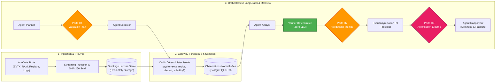
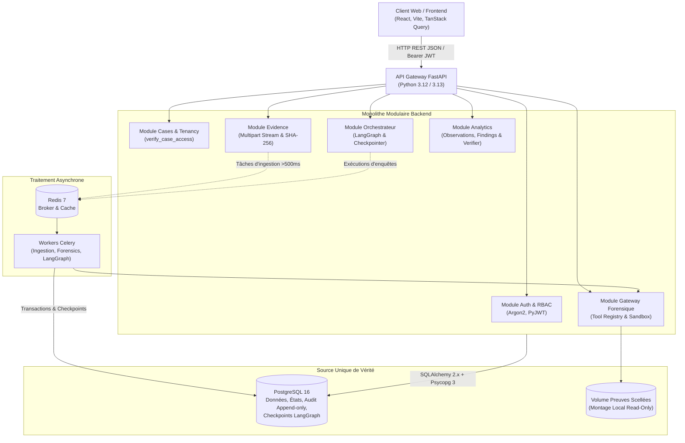

# IRYX — Plateforme d'Investigation Numérique (DFIR) & d'Analyse de Fraudes Supervisée par IA

[](https://www.python.org/)
[](https://fastapi.tiangolo.com)
[](https://github.com/langchain-ai/langgraph)
[](https://www.postgresql.org/)
[](https://docs.celeryq.dev/)
[](backend/tests)
[](https://docs.astral.sh/ruff/)

---

## 1. Présentation Générale

**IRYX** est une plateforme d'investigation numérique (*Digital Forensics and Incident Response* — **DFIR**) et d'analyse de fraudes complexes, orchestrée par des agents d'intelligence artificielle spécialisés et rigoureusement supervisée par des analystes humains (*Human-in-the-Loop*).

Face à l'augmentation critique du volume d'artefacts forensiques (images mémoires de plusieurs dizaines de gigaoctets, ruches de registre Windows, journaux d'événements EVTX massifs) et à la pénurie globale d'experts seniors en réponse à incident, **IRYX** automatise le travail laborieux de collecte, normalisation et pré-corrélation, tout en éliminant les hallucinations d'IA grâce à une **séparation stricte entre inférence probabiliste et validation déterministe**.



---

## 2. Principes Directeurs & Invariants de Conception

La conception d'IRYX repose sur des règles de sécurité et de rigueur forensique intangibles :

1. **Priorité absolue à la preuve (*Evidence-First*)** :
   - Tout fichier importé est streamé par blocs de 64 Ko, stocké sur un volume monté exclusivement en **lecture seule** (`read-only`) pour tous les conteneurs et workers, et scellé immédiatement par une **empreinte cryptographique SHA-256**.
   - L'écrasement silencieux d'une preuve est strictement interdit ; chaque nouvel upload génère une entité distincte et horodatée.
2. **Supervision humaine incontournable (*Human-in-the-Loop*)** :
   - Aucune décision opérationnelle ni action de diagnostic lourd n'est exécutée en roue libre par un agent. Le système impose trois portes de synchronisation bloquantes :
     - **Porte H1** : Validation humaine du plan d'outils proposé par le `Planner` avant toute exécution technique.
     - **Porte H2** : Validation humaine des constats techniques (`Findings`) après vérification formelle.
     - **Porte H3** : Autorisation explicite de transmission externe avant toute génération de rapport assistée par un LLM distant.
3. **Vérificateur 100% Déterministe (*Strictly Zero-LLM Verifier*)** :
   - Pour éliminer tout risque d'affabulation ou d'hallucination, le composant `Verifier` est un algorithme purement déterministe (SQL / intégrité de graphe). Il refuse automatiquement tout finding dont les identifiants d'observations ou d'outils ne correspondent pas exactement à la base de données.
4. **Exécution isolée et hermétique (*Forensic Gateway Sandbox*)** :
   - Aucun agent n'a accès à un shell système (`/bin/bash`, PowerShell, CMD).
   - Les outils techniques s'exécutent en environnement confiné : utilisateur non privilégié (`non-root`), réseau coupé (`air-gap` / `network: none`), temporisation d'exécution stricte (30s à 300s) et troncature contextuelle de sécurité (maximum 50 enregistrements réinjectés dans le contexte LLM pour éviter tout déni de service par saturation de contexte).
5. **Journalisation d'audit immuable en ajout seul (*Append-Only Audit Trail*)** :
   - Toute action sensible (authentification, accès dossier, téléversement de preuve, arbitrage H1/H2/H3, exécution d'outil, export) fait l'objet d'un événement d'audit (`AuditEvent`) scellé avec son empreinte de contenu. Les opérations `UPDATE` et `DELETE` sont formellement bloquées au niveau de la couche SQL.

---

## 3. Rôles des Agents Spécialisés

Le cycle d'investigation est articulé autour de rôles d'agents aux responsabilités strictement étanches :

| Rôle | Type d'Exécution | Mission Principale | Ce qu'il ne fait JAMAIS |
|---|---|---|---|
| **Planner** | Inférence LLM | Analyse la demande initiale et l'inventaire des preuves disponibles. Propose un plan d'investigation borné de 4 à 8 étapes techniques. | Ne lance aucun outil technique direct. Ne lit jamais le contenu des preuves brutes. |
| **Executor** | Procédural déterministe | Reçoit le plan validé par l'humain (Porte H1). Dispatche séquentiellement chaque étape vers la Gateway d'outils. | Ne génère aucun texte libre. N'exécute aucune commande système arbitraire hors registre. |
| **Analyst** | Inférence LLM | Interroge la base des `Observation` normalisées, identifie les corrélations suspectes et formule des constats (`Finding`). | N'invente aucun fait. Ne référence aucune preuve absente de la base relationnelle. |
| **Verifier** | Algorithmique pur (**Zéro LLM**) | Valide l'admissibilité de chaque finding en vérifiant la présence effective des observations et exécutions citées. | N'utilise aucun modèle d'IA. Ne produit aucune déduction sémantique. |
| **Corrélateur** | Moteur temporel SQL | Agrège les observations hétérogènes (EVTX, logs, ruches, RAM) et produit une frise chronologique unifiée ordonnée en UTC. | Ne modifie pas les horodatages originaux. N'invente pas d'événements intermédiaires. |
| **Rapporteur** | Inférence LLM (sous H3) | Rédige le document de synthèse d'incident (Markdown / JSON scellé) à partir des findings certifiés et des données pseudonymisées. | Ne consulte aucune donnée brute. Ne contacte jamais de LLM externe sans pseudonymisation préalable. |

---

## 4. Registre des Outils Forensiques Intégrés

Tous les analyseurs techniques sont encapsulés au sein du registre sécurisé de la **Forensic Gateway** :

| Nom de l'Outil | Bibliothèque Sous-Jacente | Périmètre & Artefacts Pris en Charge | Timeout |
|---|---|---|---|
| `hash_sha256` | `hashlib` (Standard Python) | Hachage cryptographique de fichiers de preuve ou segments de blocs. | 30 s |
| `parse_text_logs` | Standard Python / Regex | Parsing structuré de fichiers de logs texte brut et CSV, normalisation UTC. | 60 s |
| `parse_evtx` | `python-evtx` (Pur Python) | Journaux d'événements Windows : canaux `Security`, `System`, `PowerShell` (EventID 4104). | 180 s |
| `parse_registry` | `regipy` (Pur Python) | Ruches de registre Windows (SYSTEM, SOFTWARE, NTUSER.DAT) : persistance Run/RunOnce, profils. | 120 s |
| `parse_execution` | `dissect` (Pur Python) | Artefacts d'exécution Windows récents (fichiers Prefetch). | 120 s |
| `analyze_memory` | `volatility3 == 2.7.0` | Analyse de captures RAM avec symboles ISF préchargés hors ligne. Plugins autorisés : `windows.info`, `windows.pslist`, `windows.pstree`, `windows.cmdline`, `windows.netscan`, `windows.malware.malfind`. | 300 s |

---

## 5. Architecture Technique Globale

Le système est conçu sous forme d'un **monolithe modulaire** complété par un pool de **workers Celery** asynchrones :



---

## 6. Structure du Dépôt

```text
IRYX/
├── backend/                       # Socle applicatif serveur (FastAPI, SQLAlchemy, Celery)
│   ├── migrations/                # Scripts de migrations de schéma Alembic (001 à 007)
│   ├── src/iryx/                  # Code source modulaire Python
│   │   ├── ai/                    # Client LLM unifié compatible OpenAI, prompts & schémas
│   │   ├── analytics/             # Observations, Findings et composant Verifier déterministe
│   │   ├── api/                   # Dépendances API communes et sessions DB
│   │   ├── auth/                  # Modèles User/Membership, hachage Argon2 et jetons JWT
│   │   ├── cases/                 # Dossiers d'investigation et sécurité multi-tenant
│   │   ├── core/                  # Configuration BaseSettings, sécurité, logging JSON, Celery
│   │   ├── db/                    # Moteur SQLAlchemy 2.x et initialisation des sessions
│   │   ├── evidence/              # Upload streaming, hachage SHA-256 et tâches Celery
│   │   ├── gateway/               # Registre d'outils, exécuteur confiné et parsers forensiques
│   │   │   └── tools/             # Analyseurs EVTX, Registre, Prefetch, Volatility 3, Logs
│   │   ├── orchestrator/          # Machine d'états LangGraph, checkpointer Postgres, portes H1/H2/H3
│   │   ├── organizations/         # Gestion multi-organisations et rôles RBAC
│   │   └── main.py                # Point d'entrée de l'application FastAPI & middlewares
│   ├── tests/                     # Suite complète de tests unitaires et d'intégration (871 tests)
│   ├── .env.example               # Modèle exhaustif des variables d'environnement
│   ├── alembic.ini                # Configuration du gestionnaire de migrations Alembic
│   ├── pyproject.toml             # Déclaration des dépendances et métadonnées du paquet iryx
│   └── README.md                  # Documentation technique spécialisée du back-end
│
├── docs/                          # Spécifications détaillées, décisions d'architecture et contrats
│   ├── adr/                       # Décisions d'architecture formelles (ADR-0001 à ADR-0011)
│   ├── contrat/                   # Contrat d'interface OpenAPI normalisé (openapi.json)
│   ├── frontend/                  # Documentation des écrans, routes et tokens du client web
│   ├── 00-contexte-produit.md     # Vision produit, personas et promesse de valeur
│   ├── 01-architecture-technique.md# Décisions technologiques figées (D-01 à D-26)
│   ├── 02-agents-et-outils.md     # Spécifications de la Gateway et contrats des agents
│   ├── 03-modele-de-donnees.md    # Schéma des 13 entités et invariants relationnels
│   ├── 04-securite-et-gates.md    # Règles de cloisonnement, portes H1/H2/H3 et Presidio
│   ├── 05-conventions-backend.md  # 14 règles de développement et critères bloquants
│   ├── 06-perimetre-mvp.md        # Délimitation stricte du périmètre MVP
│   ├── 07-api-llm-et-dependances.md# Configuration des modèles LLM et versions logicielles
│   └── 08-architecture-backend.md # Index de référence de l'architecture backend
│
├── sources-frontend/              # Spécifications UX, design tokens et guide frontend
│   └── design/                    # Tokens de conception JSON et palette graphique IRYX
│
├── pyproject.toml                 # Workspace UV racine et configuration Pytest globale
└── README.md                      # Le présent document
```

---

## 7. Prérequis & Stack Technologique

### Prérequis Système
- **Système d'exploitation** : Linux, macOS ou Windows avec WSL2 / PowerShell.
- **Python** : Version `>= 3.12` (compatible 3.13).
- **Gestionnaire de paquets** : [uv](https://docs.astral.sh/uv/) (recommandé pour sa rapidité et reproductibilité) ou `pip`.
- **Base de données** : PostgreSQL 16+.
- **Courtier de messages** : Redis 7+.

### Dépendances Logicielles Clés
| Composant | Technologie | Rôle |
|---|---|---|
| **API Web** | FastAPI >= 0.115 | Framework HTTP asynchrone haute performance |
| **Validation** | Pydantic v2 & Pydantic-Settings | Validation stricte des données et chargement d'environnement |
| **ORM & Driver** | SQLAlchemy 2.0+ & Psycopg 3 | Requêtage typé et pool de connexions PostgreSQL natif |
| **Migrations** | Alembic >= 1.13 | Suivi et application transactionnelle des schémas SQL |
| **Workers Asynchrones** | Celery 5.4+ & Redis 7 | Exécution en arrière-plan des tâches lourdes (>500ms) |
| **Orchestration d'IA** | LangGraph >= 0.2.20 | Graphe d'états d'investigation avec reprise sur incident |
| **Point de Contrôle** | LangGraph Checkpoint Postgres | Sauvegarde transactionnelle de l'état de l'orchestrateur |
| **Client LLM** | SDK Officiel `openai` + `tenacity` | Interface unifiée pour modèles compatibles OpenAI / locaux |
| **Sécurité & Hash** | `pwdlib[argon2]`, `pyjwt`, `hashlib` | Hachage de mots de passe, tokens JWT et empreintes SHA-256 |
| **Outils Forensiques** | `python-evtx`, `regipy`, `dissect`, `volatility3` | Analyseurs d'artefacts systèmes et captures mémoire |

---

## 8. Démarrage Rapide

### 8.1 Cloner le Dépôt
```bash
git clone https://github.com/votre-organisation/iryx.git
cd iryx
```

### 8.2 Configurer l'Environnement Virtuel
Avec `uv` (recommandé) :
```bash
uv venv
# Activation sous Linux / macOS :
source .venv/bin/activate
# Activation sous Windows (PowerShell) :
.venv\Scripts\Activate.ps1

# Synchronisation des dépendances avec le fichier de verrouillage
uv sync
```

### 8.3 Initialiser les Variables d'Environnement
Copiez le modèle dans le dossier `backend` :
```bash
cp backend/.env.example backend/.env
```
Ajustez les valeurs dans `backend/.env` (connexion PostgreSQL, Redis, clés d'API LLM et répertoires de stockage des preuves).

### 8.4 Initialiser la Base de Données
Assurez-vous que votre instance PostgreSQL 16 est active, puis appliquez les migrations Alembic :
```bash
cd backend
alembic upgrade head
cd ..
```

### 8.5 Lancer les Services

**Terminal 1 — API HTTP FastAPI :**
```bash
cd backend
uvicorn iryx.main:app --host 0.0.0.0 --port 8000 --reload
```
L'API est accessible à l'adresse : `http://localhost:8000`  
La documentation interactive OpenAPI Swagger est consultable sur : `http://localhost:8000/docs`

**Terminal 2 — Worker Celery :**
```bash
cd backend
celery -A iryx.core.celery_app worker --loglevel=info --pool=threads --concurrency=4
```

---

## 9. Tests & Assurance Qualité

Le projet applique une politique stricte de qualité de code avec typage intégral et suite de tests exhaustive :

```bash
# Exécution de l'intégralité de la suite de tests (871 tests unitaires et d'intégration)
pytest backend/tests

# Analyse statique et respect des conventions (Zéro avertissement toléré)
ruff check backend

# Vérification du formatage du code
ruff format --check backend
```

---

## 10. Décisions d'Architecture Formelles (ADR)

Les choix techniques majeurs sont documentés et arbitrés sous forme d'ADR (*Architecture Decision Records*) dans le dossier [`docs/adr/`](docs/adr/) :

- [ADR-0001 : Monolithe modulaire et workers pour le MVP](docs/adr/ADR-0001-monolithe-modulaire-et-workers.md)
- [ADR-0002 : PostgreSQL plutôt que SQLite par dossier](docs/adr/ADR-0002-postgresql-plutot-que-sqlite.md)
- [ADR-0003 : Client LLM unique compatible OpenAI](docs/adr/ADR-0003-client-llm-unique-compatible-openai.md)
- [ADR-0004 : Formats de rapport Markdown et JSON scellés](docs/adr/ADR-0004-formats-rapport-markdown-json-scelles.md)
- [ADR-0005 : Téléversement en streaming et taille maximale des preuves](docs/adr/ADR-0005-televersement-streaming-et-taille-max-preuves.md)
- [ADR-0006 : Cycle de vie et expiration des jetons JWT](docs/adr/ADR-0006-cycle-de-vie-et-expiration-jetons-jwt.md)
- [ADR-0007 : Persistance transactionnelle d'état LangGraph via Checkpointer PostgreSQL](docs/adr/ADR-0007-persistance-etat-langgraph-checkpointer-postgresql.md)
- [ADR-0008 : Protocole et cadence de polling HTTP avec en-tête Retry-After](docs/adr/ADR-0008-protocole-et-cadence-polling-http-retry-after.md)
- [ADR-0009 : Mise à jour hors ligne des symboles Volatility 3](docs/adr/ADR-0009-mise-a-jour-hors-ligne-symboles-volatility-3.md)
- [ADR-0010 : Politique de rétention locale des preuves](docs/adr/ADR-0010-politique-retention-locale-preuves-mvp.md)
- [ADR-0011 : Transport de l'authentification et gestion de session sans état](docs/adr/ADR-0011-transport-authentification.md)

---

## 11. Licence & Propriété Intellectuelle

IRYX est développé dans le respect des standards de sécurité et de confidentialité forensique. Tous droits réservés. Consulter les mentions contractuelles de votre organisation pour les conditions d'exploitation et de distribution.
