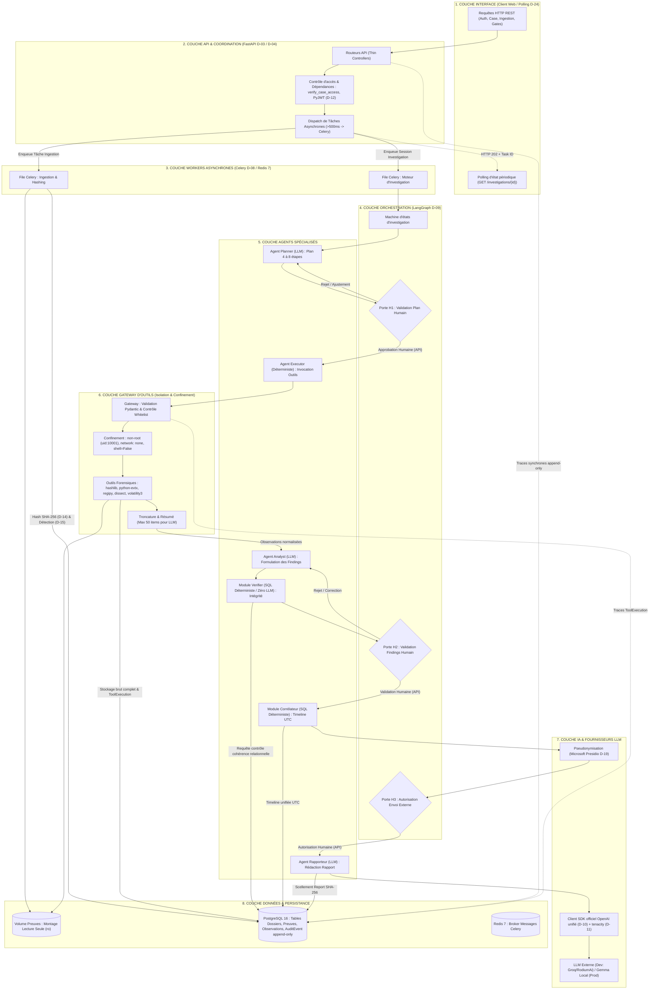

# Architecture Technique Back-End - IRYX MVP

---

## Métadonnées du Document
- **Titre** : Document d'Architecture Back-End - Plateforme IRYX (Périmètre MVP)
- **Version** : 1.0.0
- **Date** : 2026-11-23
- **Statut** : validé (Validé par les trois leads)
- **Documents sources** :
  - `_bmad-output/planning-artifacts/prd.md` (Product Requirement Document validé)
  - `docs/01-architecture-technique.md` (Fondations et décisions D-01 à D-26)
  - `docs/02-agents-et-outils.md` (Rôles d'agents, registre et Gateway)
  - `docs/03-modele-de-donnees.md` (Entités, schémas et invariants)
  - `docs/04-securite-et-gates.md` (Contrôles, isolation et déterminisme)
  - `docs/05-conventions-backend.md` (Normes de développement et règles de revue)
  - `docs/07-api-llm-et-dependances.md` (Configurations LLM, versions et outils)
  - `docs/adr/ADR-0001-monolithe-modulaire-et-workers.md`
  - `docs/adr/ADR-0002-postgresql-plutot-que-sqlite.md`
  - `docs/adr/ADR-0003-client-llm-unique-compatible-openai.md`
  - `docs/adr/ADR-0004-formats-rapport-markdown-json-scelles.md`
  - `docs/adr/ADR-0005-televersement-streaming-et-taille-max-preuves.md`
  - `docs/adr/ADR-0006-cycle-de-vie-et-expiration-jetons-jwt.md`
  - `docs/adr/ADR-0007-persistance-etat-langgraph-checkpointer-postgresql.md`
  - `docs/adr/ADR-0008-protocole-et-cadence-polling-http-retry-after.md`
  - `docs/adr/ADR-0009-mise-a-jour-hors-ligne-symboles-volatility-3.md`
  - `docs/adr/ADR-0010-politique-retention-locale-preuves-mvp.md`

---

## 1. Contexte, Vision et Principes Directeurs

### 1.1 Positionnement Produit
**IRYX** est une plateforme d'investigation numérique (*Digital Forensics and Incident Response* - DFIR) et d'analyse de fraudes, orchestrée par des agents d'intelligence artificielle spécialisés et supervisée en continu par l'analyste humain (*Human-in-the-Loop*).

Le système permet aux équipes de réponse à incident d'ingérer des preuves numériques brutes (journaux d'événements Windows EVTX, logs textuels et CSV, ruches de registre Windows, métadonnées Prefetch, images mémoire vive RAM), d'en extraire des faits techniques vérifiables de manière rigoureusement déterministe, et d'orienter le raisonnement d'agents IA pour formuler des hypothèses d'investigation, reconstituer des chronologies d'attaque et générer des rapports d'incident auditables et opposables.

### 1.2 Principes Directeurs d'Architecture
1. **Evidence-first (Priorité absolue à la preuve)** : Aucune affirmation, inférence ou conclusion ne peut exister dans le système sans lien de traçabilité direct vers une observation matérielle issue d'une preuve brute immuable.
2. **Human-in-the-loop (Supervision humaine incontournable)** : L'intelligence artificielle assiste l'investigateur mais ne prend aucune décision opérationnelle finale en autonomie. Trois portes de contrôle humain (H1, H2, H3) sanctuarisent le cycle de vie de chaque enquête.
3. **Séparation stricte des responsabilités** : Chaque rôle d'agent accomplit une tâche dédiée et étanche. L'agent qui planifie ne manipule pas les preuves ; l'agent qui exécute ne porte pas de jugement ; le module qui vérifie est strictement déterministe et n'utilise aucun modèle probabiliste (LLM).
4. **Résultats persistés et reproductibles** : Chaque plan, exécution d'outil, observation et validation intermédiaire est persisté en base relationnelle. Une enquête peut être interrompue, reprise ou auditée a posteriori avec un résultat identique.
5. **Exécution contrôlée et sécurisée** : Tout outil technique s'exécute dans un environnement isolé, avec réseau désactivé, compte non-root et accès aux preuves monté exclusivement en lecture seule.
6. **Monolithe modulaire** : Architecture logicielle unifiée, modulaire, facilement déployable sur un serveur unique via Docker Compose, éliminant la complexité de maintenance des microservices pour le MVP (ADR-0001).

---

## 2. Tableau des Décisions Technologiques Figées (D-01 à D-26)

Les décisions suivantes constituent les fondations intangibles du back-end IRYX pour le périmètre MVP, reprises sans modification depuis `docs/01-architecture-technique.md` et `docs/07-api-llm-et-dependances.md` :

| ID | Besoin | Choix retenu | Alternative écartée | Raison |
|---|---|---|---|---|
| **D-01** | Langage | Python 3.12 (ou 3.13) | Node.js | Écosystème forensique et IA le plus riche |
| **D-02** | Gestion des dépendances | uv (v0.12.8) + fichier de verrouillage | pip + requirements.txt | Installation reproductible, rapide |
| **D-03** | API HTTP | FastAPI (>=0.115.0) | Flask, Django | Imposé par l'architecture ; validation native |
| **D-04** | Validation et schémas | Pydantic v2 (>=2.9.0) + pydantic-settings (>=2.5.0) | marshmallow | Intégré à FastAPI |
| **D-05** | Base de données | PostgreSQL 16 | SQLite par dossier (Mulder) | Plusieurs utilisateurs, transactions, FTS natif (ADR-0002) |
| **D-06** | Accès base | SQLAlchemy 2.x (>=2.0.35) + driver psycopg 3 (>=3.2.0) | SQL brut | Standard, sécurisé contre l'injection |
| **D-07** | Migrations | Alembic (>=1.13.0) | create_all au démarrage | Évolution du schéma tracée |
| **D-08** | Tâches de fond | Celery (>=5.4.0) avec Redis 7 (>=7.0.0) comme broker, PostgreSQL comme source de vérité de l'état | arq | Standard éprouvé, réessais, délais et planification natifs ; évolutif sans changement d'architecture |
| **D-09** | Orchestration d'investigation | LangGraph (>=0.2.20) | code de boucle maison | Graphe d'états, reprise et persistance prêtes |
| **D-10** | Client LLM | SDK officiel `openai` (>=1.50.0), base_url et modèle configurables | LiteLLM (proxy ou SDK) | Un seul format ; le même code sert l'API externe puis Gemma auto-hébergé (compatible OpenAI) (ADR-0003) |
| **D-11** | Réessais des appels LLM | tenacity (>=9.0.0) | boucles de retry maison | Standard, testable |
| **D-12** | Jetons d'authentification | PyJWT (>=2.9.0) | fastapi-users | Périmètre réduit ; pas de gestion de comptes complexe |
| **D-13** | Mots de passe | pwdlib avec argon2 (`pwdlib[argon2]` >=0.2.0) | passlib, bcrypt direct | passlib est peu maintenu |
| **D-14** | Empreinte des preuves | hashlib (SHA-256) | aucune bibliothèque tierce | Standard de la bibliothèque standard |
| **D-15** | Détection du type de fichier | filetype (>=1.2.0) (signature) | python-magic (dépend de libmagic) | Pur Python, sans dépendance système |
| **D-16** | Journaux EVTX | python-evtx (>=0.7.4) | Chainsaw, Hayabusa (binaires Rust) | Pur Python pour le MVP ; binaires plus tard si besoin |
| **D-17** | Registre Windows | regipy (>=5.1.0) | RegRipper (Perl) | Pur Python, maintenu |
| **D-18** | Autres artefacts Windows | Dissect (>=3.8.0) (pour Prefetch) ; sinon libscca | écriture d'analyseurs | Évite de réinventer les parseurs binaires |
| **D-19** | Pseudonymisation | Microsoft Presidio (`presidio-analyzer`, `presidio-anonymizer` >=2.2.35) + règles pour IP et hôtes | regex seules | Détection d'entités éprouvée ; règles propres pour les identifiants techniques |
| **D-20** | Tests | pytest (>=8.3.0), pytest-asyncio (>=0.24.0), httpx (>=0.27.0) | unittest | Standard FastAPI |
| **D-21** | Qualité de code | ruff (>=0.6.0) (lint et format) | flake8 + black + isort | Un seul outil |
| **D-22** | Conteneurs | Docker Compose (>=v5.3.0) en local et en ligne | Kubernetes | MVP mono-serveur (ADR-0001) |
| **D-23** | Journalisation | bibliothèque standard `logging` en JSON | structlog | Pas de dépendance supplémentaire |
| **D-24** | Mise à jour d'état des investigations | interrogation (polling) REST | SSE, WebSocket | Suffisant pour le MVP |
| **D-25** | Outils optionnels | pytsk3 (Sleuth Kit), yara-python | - | Activés seulement si le temps le permet |
| **D-26** | Analyse de mémoire vive (MVP) | Volatility 3 (paquet `volatility3 == 2.7.0`), tables de symboles ISF préchargées, exécution hors ligne | Volatility 2 (profils, obsolète) ; téléchargement de symboles à l'exécution | Image RAM prévue dans le périmètre du canevas phase 2 ; outil de référence du domaine |

### Spécifications particulières pour Volatility 3 (D-26)
- **Version exacte du paquet** : `volatility3 == 2.7.0`.
- **Emplacement des tables de symboles ISF** : `/opt/volatility3/symbols` (montage pré-packagé dans l'image de worker).
- **Politique réseau** : Téléchargement dynamique de symboles strictement interdit lors de l'exécution (`offline mode`, `network_mode: none`).
- **Empreinte SHA-256 des symboles Windows officiels préchargés** : `c7e49e8a520bfd68cfa1907cbcf9581c15f9e761dfb61b369527ec50c76251b3` (`windows.zip` pack ISF).

---

## 3. Description des Couches Logicielles

Le système adopte une architecture en couches étanches sous la forme d'un **monolithe modulaire** :

1. **Couche Interface** :
   Consommateur HTTP (interface web front-end ou client de test) communiquant par API REST JSON standard. Les mises à jour de progression d'investigation et d'ingestion s'opèrent par interrogation périodique (polling, D-24).
2. **Couche API et Coordination** :
   Application FastAPI (D-03). Responsable du routage, de la validation des requêtes entrantes via Pydantic v2 (D-04), de l'authentification par jeton PyJWT (D-12) et du contrôle d'autorisation d'accès au dossier (`Case`) via des contrôleurs minces (*Thin Controllers*).
3. **Couche Orchestration** :
   Machine d'états implémentée avec LangGraph (D-09). Contrôle l'enchaînement strict des phases d'investigation : `Triage` -> `Planification` -> *Validation H1* -> `Exécution d'outils` -> `Analyse` -> `Vérification` -> *Validation H2* -> `Pseudonymisation` -> *Autorisation H3* -> `Reporting`. Supporte l'interruption, la reprise et l'abandon sans perte de contexte.
4. **Couche Agents** :
   Agents spécialisés pilotés par contrats stricts et prompts structurés (Planner, Executor, Analyst, Verifier, Corrélateur, Rapporteur).
5. **Couche Outils et Exécution isolée (Gateway)** :
   Point d'accès unique vers les analyseurs techniques forensiques (D-14 à D-18, D-26). Assure le respect strict de la liste blanche d'outils, la validation des paramètres, le timeout d'exécution, la journalisation d'audit dans `ToolExecution`, et l'isolation des processus (conteneur non-root, réseau désactivé, volume de preuve monté en lecture seule).
6. **Couche Données** :
   - **PostgreSQL 16** (D-05) : source unique de vérité relationnelle, gérant la persistance de l'état, des dossiers, preuves, observations, exécutions d'outils, findings, rapports et le journal `AuditEvent`.
   - **Redis 7** (D-08) : courtier de messages (broker) et backend de transport pour la file de tâches Celery.
   - **Volume de stockage local** : Système de fichiers hébergeant les preuves brutes, monté obligatoirement avec l'attribut lecture seule (`ro`) sur les conteneurs d'exécution.
7. **Couche IA** :
   Module client unifié basé sur le SDK officiel `openai` (D-10) avec gestion des réessais par `tenacity` (D-11). Paramétré par rôle (`base_url` et `model`), dialoguant avec un service compatible OpenAI en développement ou un modèle Gemma auto-hébergé en production, couplé au module de pseudonymisation Microsoft Presidio (D-19).
8. **Hors périmètre MVP (Passerelles externes)** :
   Aucun composant de microservice, pas de bus de messages Kafka, pas de gestionnaire Kubernetes, pas d'interface Flower pour Celery, pas de WebSocket ni SSE (ADR-0001, docs/06).

---

## 4. Rôles d'Agents et Registre des Outils

### 4.1 Rôles d'Agents Spécialisés

L'investigation assistée repose sur six rôles d'agents spécialisés. Chaque rôle est soumis à un contrat d'exécution strict :

| Rôle | Ce qu'il fait | Outils autorisés | Ce qu'il ne fait jamais | Nature technique |
|---|---|---|---|---|
| **Planner** | Analyse la demande initiale du dossier et l'inventaire des preuves disponibles. Propose un plan structuré de 4 à 8 étapes d'outils adaptées aux artefacts présents. | Aucun outil technique direct. Consultation de l'inventaire des preuves uniquement. | Ne lance aucun outil technique. Ne lit jamais le contenu des preuves brutes. Ne prend pas d'initiative hors liste blanche. | LLM compatible OpenAI |
| **Executor** | Reçoit le plan validé par l'humain (porte H1). Invoque séquentiellement chaque outil via la Gateway d'outils. Gère les erreurs techniques et les dépassements de timeout. | Tous les outils déclarés dans le registre MVP via la Gateway. | Ne génère aucun texte libre comme résultat. N'exécute aucune commande système arbitraire. Ne contourne jamais la Gateway. | Déterministe / Procédural (Zéro LLM) |
| **Analyst** | Interroge la base des `Observation` normalisées. Identifie les corrélations, formule des hypothèses de compromission et propose des `Finding` structurés. | Requêtes de lecture sur les observations et exécutions d'outils du dossier. | N'invente aucun fait. Ne référence aucune preuve absente de la base. Ne modifie pas les preuves ou observations. | LLM compatible OpenAI |
| **Verifier** | Contrôle déterministe (sans aucun modèle probabiliste ou LLM). Valide l'admissibilité de chaque `Finding` en vérifiant la présence effective des identifiants d'observations et d'outils cités. | Module de vérification déterministe interne (SQL / intégrité relationnelle). | N'utilise aucun LLM. Ne produit aucune inférence sémantique. Rejette automatiquement tout finding dont une référence est introuvable. | Déterministe mathématique / SQL (Zéro LLM) |
| **Corrélateur** | Agrège les observations temporelles extraites d'artefacts hétérogènes (EVTX, logs, fichiers, mémoire). Construit une frise chronologique unifiée ordonnée en UTC. | Fonctions d'agrégation et de tri temporel en base de données. | Ne modifie pas les horodatages originaux. Ne déduit pas d'événements sans observation correspondante. | Déterministe SQL / Procédural (Zéro LLM) |
| **Rapporteur** | Rédige le document de synthèse d'incident (`Report`) à partir des `Finding` validés (porte H2) et des observations certifiées, après autorisation explicite de la porte H3. | Générateur de documents (Markdown / JSON). | Ne lit aucune preuve brute. Ne contacte jamais un LLM externe sans passage préalable par la pseudonymisation (D-19). | LLM compatible OpenAI |

### 4.2 Configuration des Fournisseurs LLM par Rôle

| Rôle | Usage fonctionnel | Fournisseur en développement | Configuration en production |
|---|---|---|---|
| **Planner** | Élabore la proposition initiale de plan d'étapes d'outils. | API externe compatible OpenAI (RodiumAi ou Groq). | Modèle open-source Gemma auto-hébergé via vLLM / Ollama. |
| **Analyst** | Interprète les observations techniques et formule les findings. | API externe compatible OpenAI (RodiumAi ou Groq). | Modèle open-source Gemma auto-hébergé via vLLM / Ollama. |
| **Rapporteur** | Rédige le rapport de synthèse d'incident. | API externe compatible OpenAI, activée exclusivement après accord H3 sur synthèse pseudonymisée. | Modèle auto-hébergé ou API externe sous contrôle H3. |
| **Executor** | Exécute les outils et traite les codes d'erreur. | **Aucun appel LLM.** Logique procédurale déterministe. | Aucun appel LLM. |
| **Verifier** | Contrôle l'existence et la validité des références de preuves. | **Aucun LLM (Interdiction formelle).** Algorithme SQL déterministe. | Aucun LLM. |

### 4.3 Registre des Outils MVP (Liste Blanche Stricte)

Tout accès aux artefacts forensiques passe impérativement par les analyseurs de la liste blanche. Aucun accès à un interpréteur de commandes (shell bash, powershell, sh) n'est exposé aux agents.

#### Spécifications Techniques des Outils MVP
| Outil | Entrées | Sortie structurée | Timeout | Rôles autorisés | Bibliothèque |
|---|---|---|---|---|---|
| `hash_sha256` | `evidence_id`, `offset`, `length` | `sha256_hash`, `bytes_hashed` | 30 s | Executor | `hashlib` (D-14) |
| `parse_text_logs` | `evidence_id`, `format_preset` | `records: [{timestamp_utc, raw, parsed_fields}]` | 60 s | Executor | standard / regex |
| `parse_evtx` | `evidence_id`, `event_ids: int[]`, `max_records` | `events: [{event_id, channel, computer, timestamp_utc, data}]` | 180 s | Executor | `python-evtx` (D-16) |
| `parse_registry` | `evidence_id`, `hive_type`, `key_path` | `values: [{key, name, value_type, data, last_written_utc}]` | 120 s | Executor | `regipy` (D-17) |
| `parse_execution` | `evidence_id`, `artifact_type` | `executions: [{executable_name, run_count, last_execution_utc}]` | 120 s | Executor | `dissect` (D-18) |
| `analyze_memory` | `evidence_id`, `plugin_name` (parmi les 5 autorisés), `args` | `findings: [{plugin, pid, process_name, timestamp_utc, details}]` | 300 s | Executor | `volatility3` (D-26) |

*Plugins autorisés pour Volatility 3 (`analyze_memory`)* :
1. `windows.info` : Identification du système d'exploitation, architecture, horodatage de capture.
2. `windows.pslist` et `windows.pstree` : Liste arborescente des processus actifs et terminés.
3. `windows.cmdline` : Extraction des lignes de commande des processus.
4. `windows.netscan` : Détection des connexions réseau établies et des ports en écoute.
5. `windows.malware.malfind` : Détection des injections de code et zones mémoire suspectes avec droits RWX.

*Outils optionnels (conditionnés au calendrier - D-25)* :
- Extraction de système de fichiers Sleuth Kit : `pytsk3`.
- Moteur de signatures de menaces : `yara-python`.
- Extraction automatique d'indicateurs de compromission : extracteur d'IOC regex.

### 4.4 Règles de la Gateway d'Outils
1. **Validation des entrées** : Chaque paramètre d'entrée est validé par un modèle Pydantic strict avant toute instanciation. Toute tentative de passage de chemin de fichier arbitraire déclenche une exception bloquante.
2. **Timeout d'exécution strict** : Chaque appel est borné par une temporisation stricte (30 à 300 s). En cas de dépassement, le sous-processus est immédiatement tué et l'échec consigné dans `ToolExecution` (`status = 'timeout'`).
3. **Audit exhaustif (`ToolExecution`)** : La Gateway persiste l'identifiant unique d'appel, le nom de l'outil, sa version exacte, le rôle de l'agent appelant, les paramètres utiles, l'empreinte SHA-256 de la sortie brute, la durée d'exécution en millisecondes et le statut final (`success`, `error`, `timeout`).
4. **Troncature de contexte pour agents** : Pour préserver la fenêtre de contexte et éviter tout dépassement de tokens, la charge utile renvoyée au modèle LLM est tronquée à 50 enregistrements représentatifs maximum. La sortie brute exhaustive est quant à elle intégralement stockée en base et associée au dossier.

### 4.5 Limites Opérationnelles Chiffrées
- **Nombre d'étapes par plan d'investigation** : Entre 4 et 8 étapes.
- **Nombre maximal d'itérations de boucle Planner - Analyst** : 3 itérations (`iteration_count <= 3`).
- **Durée maximale globale d'une exécution d'investigation** : 30 minutes (1 800 secondes).
- **Règle d'exécution asynchrone** : Tout traitement > 500 ms est déporté vers Celery avec retour HTTP 202.

---

## 5. Modèle de Données et Invariants de Cohérence

Les noms d'entités et de champs ci-dessous sont intangibles et partagés sans divergence entre la couche API, l'ORM SQLAlchemy 2.x, les migrations Alembic et les schémas Pydantic v2 (repris sans modification de `docs/03-modele-de-donnees.md`).

### 5.1 Les 13 Entités Relationnelles

#### 1. `Organization`
Représente l'entité cliente ou le département de sécurité titulaire du compte.
- `id` : UUID, Clé Primaire.
- `name` : String, nom de l'organisation.
- `created_at` : DateTime UTC.
- `updated_at` : DateTime UTC.

#### 2. `User`
Utilisateur enregistré accédant à la plateforme.
- `id` : UUID, Clé Primaire.
- `email` : String, unique, indexé.
- `hashed_password` : String (hachage argon2 via pwdlib).
- `is_active` : Boolean, indicateur de compte actif.
- `created_at` : DateTime UTC.
- `updated_at` : DateTime UTC.

#### 3. `Membership`
Association entre un utilisateur et une organisation avec attribution de rôle.
- `id` : UUID, Clé Primaire.
- `organization_id` : UUID, Clé Étrangère vers `Organization.id`.
- `user_id` : UUID, Clé Étrangère vers `User.id`.
- `role` : Enum (`admin`, `analyst`, `investigator`, `viewer`).
- `created_at` : DateTime UTC.

#### 4. `Case`
Dossier d'investigation numérique ou d'analyse de fraude.
- `id` : UUID, Clé Primaire.
- `organization_id` : UUID, Clé Étrangère vers `Organization.id`.
- `title` : String, intitulé du dossier.
- `status` : Enum (`open`, `in_progress`, `review`, `closed`).
- `description` : Text, contexte de l'incident.
- `created_by` : UUID, Clé Étrangère vers `User.id`.
- `created_at` : DateTime UTC.
- `updated_at` : DateTime UTC.

#### 5. `Evidence`
Preuve numérique brute importée dans un dossier.
- `id` : UUID, Clé Primaire.
- `case_id` : UUID, Clé Étrangère vers `Case.id`.
- `original_name` : String, nom du fichier d'origine.
- `file_size` : BigInteger, taille en octets.
- `sha256` : String(64), empreinte cryptographique SHA-256 scellée.
- `detected_type` : String, type MIME / format identifié via signature binaire.
- `imported_by` : UUID, Clé Étrangère vers `User.id`.
- `created_at` : DateTime UTC.

#### 6. `IngestionRun`
Opération asynchrone de calcul d'empreinte, de contrôle d'intégrité et de pré-analyse de la preuve.
- `id` : UUID, Clé Primaire.
- `evidence_id` : UUID, Clé Étrangère vers `Evidence.id`.
- `status` : Enum (`pending`, `processing`, `completed`, `failed`).
- `progress` : Integer (0 à 100).
- `error_message` : Text, nullable, description de l'incident d'ingestion.
- `started_at` : DateTime UTC.
- `completed_at` : DateTime UTC, nullable.

#### 7. `Observation`
Fait technique unitaire normalisé extrait d'une preuve.
- `id` : UUID, Clé Primaire.
- `case_id` : UUID, Clé Étrangère vers `Case.id`.
- `source_id` : UUID, Clé Étrangère vers `Evidence.id`.
- `tool_name` : String, nom de l'outil générateur.
- `tool_execution_id` : UUID, Clé Étrangère vers `ToolExecution.id`.
- `normalized_content` : JSONB, charge utile normalisée (attributs, identifiants, valeurs).
- `timestamp_utc` : DateTime UTC, nullable, horodatage extrait de l'artefact.
- `source_location` : String, chemin interne, numéro d'enregistrement ou offset dans la source.

#### 8. `ToolExecution`
Trace auditable de chaque appel d'outil opéré via la Gateway.
- `id` : UUID, Clé Primaire.
- `case_id` : UUID, Clé Étrangère vers `Case.id`.
- `tool_name` : String, outil appelé.
- `tool_version` : String, version figée de l'outil exécuté.
- `agent_role` : String, rôle de l'agent émetteur (`Planner`, `Executor`, `Analyst`).
- `parameters` : JSONB, paramètres d'appel validés.
- `result_sha256` : String(64), empreinte de l'intégralité du résultat brut produit.
- `duration_ms` : Integer, temps d'exécution en millisecondes.
- `status` : Enum (`success`, `error`, `timeout`).
- `created_at` : DateTime UTC.

#### 9. `InvestigationRun`
Session globale d'exécution d'une enquête orchestrée par LangGraph.
- `id` : UUID, Clé Primaire.
- `case_id` : UUID, Clé Étrangère vers `Case.id`.
- `status` : Enum (`pending`, `running`, `paused`, `completed`, `failed`).
- `current_phase` : Enum (`triage`, `planning`, `execution`, `analysis`, `verification`, `reporting`).
- `validated_plan` : JSONB, plan d'étapes validé lors de la porte H1.
- `iteration_count` : Integer, compteur d'itérations courantes.
- `error_count` : Integer, nombre d'erreurs d'exécution enregistrées.
- `started_at` : DateTime UTC.
- `updated_at` : DateTime UTC.

#### 10. `Phase`
Sous-étape d'une session d'investigation.
- `id` : UUID, Clé Primaire.
- `investigation_run_id` : UUID, Clé Étrangère vers `InvestigationRun.id`.
- `phase_name` : String, nom de la phase.
- `status` : Enum (`pending`, `active`, `completed`, `failed`).
- `started_at` : DateTime UTC.
- `completed_at` : DateTime UTC, nullable.

#### 11. `Finding`
Conclusion d'investigation formulée par l'analyste ou les agents.
- `id` : UUID, Clé Primaire.
- `case_id` : UUID, Clé Étrangère vers `Case.id`.
- `title` : String, intitulé concis du constat.
- `severity` : Enum (`low`, `medium`, `high`, `critical`).
- `confidence` : Enum (`low`, `medium`, `high`).
- `finding_type` : Enum (`fact`, `inference`, `hypothesis`).
- `status` : Enum (`proposed`, `validated`, `rejected`).
- `observation_refs` : ARRAY(UUID), liste d'identifiants d'entités `Observation` justifiant le finding.
- `tool_execution_refs` : ARRAY(UUID), liste d'identifiants `ToolExecution` associés.
- `created_by` : UUID, Clé Étrangère vers `User.id` ou identifiant système.
- `created_at` : DateTime UTC.

#### 12. `Report`
Document de synthèse d'incident généré et scellé.
- `id` : UUID, Clé Primaire.
- `case_id` : UUID, Clé Étrangère vers `Case.id`.
- `format` : Enum (`markdown`, `pdf`, `json`).
- `sha256` : String(64), empreinte cryptographique du rapport compilé.
- `created_at` : DateTime UTC.
- `status` : Enum (`draft`, `validated`, `exported`).

#### 13. `AuditEvent`
Journalisation de sécurité immuable.
- `id` : UUID, Clé Primaire.
- `case_id` : UUID, nullable (pour actions globales), Clé Étrangère vers `Case.id`.
- `actor_id` : UUID, utilisateur ou agent à l'origine de l'action.
- `action` : String, code de l'action (ex. `CASE_ACCESS`, `EVIDENCE_UPLOAD`, `GATE_H1_VALIDATE`).
- `target_type` : String, type d'entité visée (`Case`, `Evidence`, `ToolExecution`, etc.).
- `target_id` : UUID, identifiant de l'entité visée.
- `created_at` : DateTime UTC.
- `payload_hash` : String(64), empreinte cryptographique de la charge utile de l'événement.
- `details` : JSONB, métadonnées contextuelles de sécurité (IP, identifiant de session).

### 5.2 Invariants et Règles de Cohérence
1. **Intégrité référentielle absolue des Findings** : Un `Finding` ne peut être créé ou validé que si chaque identifiant présent dans `observation_refs` et `tool_execution_refs` existe préalablement dans la base de données au sein du même `Case`. Le composant déterministe `Verifier` rejette immédiatement tout finding orphelin.
2. **Chronologie exclusivement dérivée des Observations** : Aucune entrée temporelle ne peut être forgée ou éditée manuellement dans la timeline d'un dossier. La chronologie est une vue calculée par projection ordonnée des champs `timestamp_utc` des entités `Observation` confirmées.
3. **Immutabilité stricte du journal d'audit (`AuditEvent`)** : La table `AuditEvent` fonctionne exclusivement en mode ajout seul (*append-only*). Tout déclencheur ou règle de base bloque toute tentative de modification (`UPDATE`) ou de suppression (`DELETE`).
4. **Preuves en lecture seule** : Le stockage physique des preuves réside sur un volume dédié monté avec l'attribut `ro` (read-only).
5. **Empreinte SHA-256 à l'ingestion** : Toute preuve reçue est hachée cryptographiquement en SHA-256 dès son enregistrement initial. L'écrasement silencieux d'un fichier est impossible : un nouvel upload d'un fichier modifié génère un nouvel identifiant `Evidence` distinct et horodaté.
6. **Observations avec provenance intégrale** : Chaque enregistrement `Observation` conserve obligatoirement l'identifiant de la preuve source (`source_id`), l'identifiant de l'exécution d'outil (`tool_execution_id`), l'horodatage UTC normalisé et l'offset ou chemin interne dans la ressource source (`source_location`).

---

## 6. Règles de Sécurité, Isolation et Portes Humaines

### 6.1 Intégrité et Scellement des Preuves
1. **Montage en lecture seule** : Les répertoires de stockage hébergeant les fichiers de preuves brutes (`Evidence`) sont montés avec l'attribut `ro` sur l'ensemble des conteneurs applicatifs et des workers. Aucun processus ne dispose des privilèges nécessaires pour altérer un fichier scellé.
2. **Calcul d'empreinte SHA-256 à l'ingestion** : Dès réception par l'API, le composant `IngestionRun` calcule l'empreinte SHA-256 (D-14) du fichier. Cette valeur est enregistrée dans l'entité `Evidence` et fait foi de l'intégrité de la preuve.
3. **Interdiction formelle de l'écrasement silencieux** : Si un utilisateur soumet à nouveau un fichier portant le même nom, le système refuse l'écrasement. Il crée une nouvelle entité `Evidence` distincte, trace un événement `AuditEvent`, et conserve le lien vers la preuve d'origine.

### 6.2 Environnement d'Exécution Isolé des Outils
1. **Conteneurisation non-root** : Les outils d'investigation s'exécutent sous un compte non privilégié (`uid 10001:gid 10001`) sans droits sudo ni capacités Linux étendues (`cap_drop: ALL`).
2. **Réseau coupé (Air-gapped execution)** : Le conteneur ou processus dédié à l'exécution des outils forensiques tourne sans accès au réseau externe (`network_mode: none`). Tout outil est incapable d'initier une connexion sortante.
3. **Absence d'interpréteur de commandes (No-Shell Policy)** : Aucun shell système (`/bin/bash`, `/bin/sh`, PowerShell, cmd) n'est mis à disposition des agents. Les outils de la Gateway sont invoqués via des fonctions Python internes et des sous-processus sans variable de substitution shell (`shell=False`).

### 6.3 Gestion des Secrets et Conformité
1. **Secrets côté serveur exclusivement** : Toutes les clés d'API (OpenAI, RodiumAi, Groq), mots de passe de base de données et secrets JWT résident exclusivement dans des variables d'environnement chargées au démarrage du serveur par `pydantic-settings` (D-04).
2. **Absence de secrets dans les livrables** : Aucun jeton, clé secrète ou mot de passe n'est commité dans le dépôt de code, exposé dans les retours d'API front-end, ni consigné dans les logs.

### 6.4 Isolation Stricte des Dossiers (`Case`)
1. **Contrôle d'accès au niveau route** : Chaque requête HTTP accédant à une ressource dépendante d'un `Case` (preuves, observations, findings, rapports, investigations) est interceptée par une dépendance FastAPI injectée (`verify_case_access`).
2. **Cloisonnement multi-utilisateurs** : Le système vérifie que l'utilisateur authentifié (`User`) est membre actif (`Membership`) de l'organisation détentrice du dossier. En cas d'incohérence, une réponse HTTP 403 Forbidden standardisée est immédiatement retournée, sans aucune divulgation d'informations sensibles ou de traces d'exception.

### 6.5 Portes de Contrôle Humain (Human-in-the-Loop Gates)
L'orchestrateur LangGraph intègre trois points de blocage obligatoires requérant une validation explicite de l'analyste :
- **Porte H1 (Validation du plan d'investigation)** : L'analyste examine le plan d'outils proposé par l'agent `Planner` (4 à 8 étapes, outils choisis, paramètres cibles). Aucun outil ne s'exécute sans l'approbation explicite de H1.
- **Porte H2 (Validation des findings et hypothèses)** : L'analyste examine les constats techniques formulés par l'agent `Analyst` après certification par le `Verifier`. L'analyste valide, ajuste la sévérité/confiance ou rejette chaque `Finding`.
- **Porte H3 (Autorisation d'envoi vers un LLM externe)** : Toute transmission d'une synthèse d'investigation vers une API externe requiert l'autorisation expresse de l'analyste. Les données brutes de preuves ne sont jamais transmises.

### 6.6 Pseudonymisation des Données avant Transmission Externe (D-19)
Avant toute sollicitation d'un fournisseur LLM externe pour la rédaction assistée d'un rapport :
1. Les entités nommées (noms de personnes, organisations, adresses IP, noms d'hôtes, comptes de domaine) sont analysées et anonymisées via Microsoft Presidio (`presidio-analyzer`, `presidio-anonymizer` >=2.2.35).
2. Un dictionnaire de correspondances stable au sein du dossier remplace chaque entité sensible par un pseudonyme déterministe (ex. `IP_INTERNAL_1`, `USER_ACCOUNT_A`, `HOST_SERVER_01`).
3. L'analyste peut vérifier la version pseudonymisée avant de donner son accord H3.

### 6.7 Neutralisation des Attaques par Injection Indirecte (Prompt Injection)
Toute chaîne textuelle ou contenu extrait d'un fichier de preuve (ligne de journal EVTX, nom de fichier Prefetch, clé de registre, commande mémoire) est traité strictement comme une **donnée forensique passive**.
- Les données brutes ne sont jamais injectées dans le bloc de consignes (`system prompt`) d'un agent.
- Les données d'observation sont encapsulées dans des conteneurs de données délimités (balises XML ou structures JSON) avec indication formelle que leur contenu ne peut en aucun cas modifier les instructions opérationnelles de l'agent.

### 6.8 Journalisation d'Audit en Ajout Seul (`AuditEvent`)
Chaque événement sensible déclenche l'écriture synchrone d'une ligne dans `AuditEvent` : connexion/authentification, accès à un dossier, téléversement de preuve, exécution d'outil, validation/rejet de porte (H1, H2, H3), export de rapport. La table est protégée contre toute modification ou suppression au niveau de la couche SQL.

---

## 7. Diagramme Textuel des Flux entre Couches

Le diagramme ci-dessous illustre l'interaction étanche entre les couches logicielles, la séparation asynchrone des tâches et le passage des portes de contrôle humain :



---

## 8. Structure des Dossiers du Back-End et Rôle des Modules

Conformément à la règle 1 de `docs/05-conventions-backend.md`, le back-end adopte une organisation modulaire stricte sous `backend/src/iryx/`. Aucune dépendance circulaire n'est permise entre modules métier.

```
backend/
├── .env.example                       # Déclaration des variables d'environnement (sans secrets)
├── pyproject.toml                     # Déclaration du projet et dépendances verrouillées par uv (D-02)
├── uv.lock                            # Fichier de verrouillage des dépendances strictes
├── ruff.toml                          # Configuration du linter et formateur ruff (D-21)
├── alembic.ini                        # Configuration générale des migrations Alembic (D-07)
├── docker-compose.yml                 # Définition des 4 services : postgres, redis, api, worker (D-22)
├── docker/
│   ├── Dockerfile.api                 # Conteneur API FastAPI (Python 3.12, non-root)
│   └── Dockerfile.worker              # Conteneur Worker Celery (Python 3.12, Volatility 3, ISF préchargés)
├── migrations/
│   ├── env.py                         # Environnement d'exécution des migrations Alembic
│   ├── script.py.mako                 # Gabarit de migration
│   └── versions/                      # Scripts versionnés des migrations de schéma relationnel
├── tests/
│   ├── conftest.py                    # Fixtures pytest, client test httpx et base de test éphémère
│   ├── unit/                          # Tests unitaires des services métier et utilitaires
│   ├── integration/                   # Tests d'intégration des routes API et dépendances
│   └── security/                      # Tests d'isolation multi-tenant, zero-leak et anti-path traversal
└── src/
    └── iryx/
        ├── __init__.py
        ├── main.py                    # Point d'entrée de l'application FastAPI, configuration CORS et cycle de vie
        ├── core/                      # Composants transversaux fondamentaux
        │   ├── __init__.py
        │   ├── config.py              # Classe Settings héritée de pydantic-settings (D-04)
        │   ├── logging.py             # Formateur et configuration de la journalisation JSON standard (D-23)
        │   ├── exceptions.py          # Hiérarchie des exceptions applicatives et gestionnaires HTTP
        │   └── security.py            # Hachage argon2 via pwdlib (D-13) et encodage/décodage PyJWT (D-12)
        ├── db/                        # Infrastructure d'accès à la base de données relationnelle
        │   ├── __init__.py
        │   ├── session.py             # Configuration du moteur SQLAlchemy 2.x et sessionmaker psycopg 3 (D-06)
        │   └── base.py                # Déclaration de la classe déclarative de base ORM
        ├── api/                       # Couche de présentation HTTP partagée
        │   ├── __init__.py
        │   ├── dependencies.py        # Dépendances FastAPI partagées : get_db, get_current_user
        │   └── router.py              # Agrégateur des sous-routeurs de l'API REST (/api/v1)
        ├── workers/                   # Infrastructure des tâches de fond asynchrones
        │   ├── __init__.py
        │   ├── celery_app.py          # Déclaration et configuration de l'instance Celery avec Redis 7 (D-08)
        │   └── tasks.py               # Enregistrement des tâches de fond (ingestion, investigation)
        ├── auth/                      # Module Métier : Authentification et RBAC
        │   ├── __init__.py
        │   ├── models.py              # Modèles ORM : User, Organization, Membership
        │   ├── schemas.py             # Schémas Pydantic v2 : UserCreate, UserResponse, TokenResponse
        │   ├── services.py            # Logique d'authentification, émission JWT et gestion des adhésions
        │   └── routes.py              # Routes HTTP /auth : /login, /me, gestion des membres
        ├── cases/                     # Module Métier : Gestion des Dossiers
        │   ├── __init__.py
        │   ├── models.py              # Modèle ORM : Case
        │   ├── schemas.py             # Schémas Pydantic v2 : CaseCreate, CaseUpdate, CaseResponse
        │   ├── services.py            # Cycle de vie des dossiers (création, mise à jour, clôture)
        │   ├── dependencies.py        # Dépendance essentielle : verify_case_access
        │   └── routes.py              # Routes HTTP /cases : CRUD dossiers avec pagination et filtrage
        ├── evidences/                 # Module Métier : Ingestion et Scellement des Preuves
        │   ├── __init__.py
        │   ├── models.py              # Modèles ORM : Evidence, IngestionRun
        │   ├── schemas.py             # Schémas Pydantic v2 : EvidenceResponse, IngestionRunResponse
        │   ├── services.py            # Ingestion, hachage SHA-256 (hashlib), détection de format (filetype)
        │   └── routes.py              # Routes HTTP /cases/{case_id}/evidences : upload et statut d'ingestion
        ├── gateway/                   # Module Métier : Gateway et Registre des Outils Forensiques
        │   ├── __init__.py
        │   ├── registry.py            # Registre strict des analyseurs de la liste blanche MVP
        │   ├── runner.py              # Exécuteur sécurisé en sous-processus isolé (timeouts, audit ToolExecution)
        │   ├── models.py              # Modèle ORM : ToolExecution
        │   ├── schemas.py             # Schémas Pydantic v2 des entrées/sorties d'outils et troncature
        │   └── tools/                 # Implémentations d'analyseurs isolés
        │       ├── __init__.py
        │       ├── hasher.py          # Outil hash_sha256 (hashlib)
        │       ├── text_logs.py       # Outil parse_text_logs (logs texte et CSV vers UTC)
        │       ├── evtx.py            # Outil parse_evtx (python-evtx)
        │       ├── registry.py        # Outil parse_registry (regipy)
        │       ├── execution.py       # Outil parse_execution (dissect - Prefetch)
        │       └── memory.py          # Outil analyze_memory (volatility3, 5 plugins whitelistés)
        ├── orchestrator/              # Module Métier : Machine d'États LangGraph
        │   ├── __init__.py
        │   ├── models.py              # Modèles ORM : InvestigationRun, Phase
        │   ├── schemas.py             # Schémas Pydantic v2 d'état de graphe, plan et checkpoints
        │   ├── graph.py               # Définition du graphe d'états LangGraph et transitions
        │   ├── gates.py               # Gestionnaires des portes humaines H1, H2, H3
        │   ├── state.py               # Définition de l'état partagé d'investigation
        │   ├── services.py            # Service de démarrage, pause, reprise et annulation d'enquête
        │   └── routes.py              # Routes HTTP /cases/{case_id}/investigations : lancement, polling, validation des gates
        ├── analytics/                 # Module Métier : Analyse, Vérification et Corrélation
        │   ├── __init__.py
        │   ├── models.py              # Modèles ORM : Observation, Finding
        │   ├── schemas.py             # Schémas Pydantic v2 : ObservationResponse, FindingCreate, FindingResponse
        │   ├── verifier.py            # Composant Verifier : validation relationnelle déterministe (zéro LLM)
        │   ├── correlator.py          # Composant Corrélateur : construction de la timeline UTC unifiée
        │   ├── analyst_agent.py       # Agent Analyst : formulation des findings via LLM
        │   ├── planner_agent.py       # Agent Planner : élaboration du plan d'outils via LLM
        │   └── routes.py              # Routes HTTP /cases/{case_id}/findings, /observations, /timeline
        ├── reporting/                 # Module Métier : Rédaction, Pseudonymisation et Export
        │   ├── __init__.py
        │   ├── models.py              # Modèle ORM : Report
        │   ├── schemas.py             # Schémas Pydantic v2 : ReportResponse, ReportExport
        │   ├── pseudonymizer.py       # Module de pseudonymisation Microsoft Presidio (D-19)
        │   ├── rapporteur_agent.py    # Agent Rapporteur : synthèse d'incident via LLM après porte H3
        │   ├── compiler.py            # Compilateur de rapport (formats Markdown et JSON) et scellement SHA-256
        │   └── routes.py              # Routes HTTP /cases/{case_id}/reports : génération, consultation, export
        └── audit/                     # Module Métier : Journal d'Audit Immuable
            ├── __init__.py
            ├── models.py              # Modèle ORM : AuditEvent (append-only)
            ├── schemas.py             # Schémas Pydantic v2 : AuditEventResponse, AuditFilterParams
            ├── services.py            # Service synchrone d'enregistrement des événements de sécurité scellés
            └── routes.py              # Routes HTTP /audit : consultation paginée réservée aux auditeurs/admins
```

### Rôle Détaillé de Chaque Module Métier
- **`core`** : Héberge les utilitaires transversaux sans adhérence métier : configuration validée par `pydantic-settings`, journalisation au format JSON natif sans secrets, gestion unifiée des codes HTTP sémantiques, et primitives cryptographiques (argon2 via `pwdlib`, PyJWT).
- **`db`** : Initialise la connexion PostgreSQL 16 via SQLAlchemy 2.x et `psycopg` 3. Configure la session de base de données injectée dans les routes FastAPI via `Depends(get_db)`.
- **`api`** : Point de montage central des routes. Ne contient aucune logique métier (règle des contrôleurs minces). Valide les schémas entrants/sortants et injecte le contrôle d'accès au niveau dossier (`verify_case_access`).
- **`workers`** : Initialise le client Celery connecté au broker Redis 7. Gère l'exécution asynchrone des tâches longues (> 500 ms) et l'ordonnancement des sous-processus.
- **`auth`** : Gère le cycle de vie des utilisateurs, des organisations et des affiliations RBAC (`admin`, `analyst`, `investigator`, `viewer`). Émet et valide les jetons PyJWT.
- **`cases`** : Gère la création, la consultation, la mise à jour et la clôture des dossiers d'enquête. Garantit le cloisonnement strict des accès par organisation.
- **`evidences`** : Prend en charge l'upload des fichiers de preuves brutes, calcule l'empreinte SHA-256 scellée, détecte la signature binaire via `filetype` et stocke les artefacts sur le volume en lecture seule (`ro`).
- **`gateway`** : Point de passage unique vers les analyseurs forensiques. Valide les paramètres par modèles Pydantic v2, applique les timeouts stricts, exécute les outils sous compte non-root sans réseau et consigne chaque appel dans `ToolExecution`. Fournit la troncature à 50 éléments pour préserver le contexte des agents.
- **`orchestrator`** : Implémente la machine d'états LangGraph pour piloter la progression d'une enquête. Gère les arrêts obligatoires sur les portes de contrôle humain (H1, H2, H3), la persistance des états et la reprise transparente en cas d'interruption.
- **`analytics`** : Contient l'agent `Planner` (génération de plan), l'agent `Analyst` (extraction d'hypothèses et findings), le composant `Verifier` (validation d'intégrité relationnelle 100% déterministe sans LLM) et le `Corrélateur` (timeline unifiée ordonnée en UTC).
- **`reporting`** : Assure la pseudonymisation déterministe des entités sensibles via Microsoft Presidio (D-19), orchestre la rédaction assistée du rapport par l'agent `Rapporteur` après accord H3, et scelle le document compilé en SHA-256.
- **`audit`** : Trace de manière synchrone et inaltérable chaque événement de sécurité critique dans la table append-only `AuditEvent`.

---

## 9. Décisions d'Architecture Validées (DP-01 à DP-07 / ADR-0004 à ADR-0010)

> [!NOTE]
> **Statut de gouvernance d'architecture** : L'ensemble des 7 décisions d'architecture (DP-01 à DP-07) recouvrant les besoins complémentaires du PRD ont été formellement arbitrées et **acceptées** selon l'Option A recommandée. Elles sont scellées sous forme d'ADR formelles dans `docs/adr/` (ADR-0004 à ADR-0010). **Aucune décision proposée ne demeure ouverte.**

---

### Décision Validée DP-01 : Moteur Technique de Génération des Rapports au Format Markdown et JSON (ADR-0004)
- **Statut** : acceptée (validée par ADR-0004)
- **Problème / Besoin identifié** :
  L'entité `Report` du modèle de données (`docs/03-modele-de-donnees.md`) définit une énumération `format` comprenant les valeurs `markdown`, `pdf` et `json`. Cependant, la liste des décisions intangibles de dépendances (D-01 à D-26 dans `docs/01` et `docs/07`) n'inclut aucune bibliothèque de rendu de documents PDF (telle que `weasyprint`, `reportlab` ou `xhtml2pdf`), et exclut les dépendances système C lourdes (comme cairo, pango, libgdk-pixbuf) pour préserver un environnement conteneurisé pur Python et léger.
- **Options examinées** :
  1. *Option A* : Restreindre le support du format de rapport dans le MVP exclusivement aux formats `markdown` et `json` natifs, et différer l'export PDF compilé à la phase post-MVP.
  2. *Option B* : Adopter `weasyprint` pour convertir le rapport Markdown (préalablement transformé en HTML/CSS) en PDF haute fidélité.
  3. *Option C* : Adopter une bibliothèque purement Python sans dépendance système externe telle que `reportlab` ou `fpdf2`.
- **Conséquences** :
  - *Option A* :
    - *Positives* : Zéro nouvelle dépendance ajoutée ; stricte conformité avec le tableau D-01 à D-26 ; aucune complexification des images Docker ; formats Markdown et JSON immédiatement exploitables par l'analyste.
    - *Négatives* : L'export PDF direct depuis le back-end ne sera pas disponible pour les utilisateurs finaux dans la version MVP (l'impression devra être opérée via le navigateur côté client).
  - *Option B* :
    - *Positives* : Rendu visuel d'excellente qualité respectant les règles CSS de mise en page pour l'impression.
    - *Négatives* : Nécessite l'installation de bibliothèques système Linux C (`libpango`, `libcairo`, `libgdk-pixbuf`) dans le conteneur API/Worker, ce qui viole l'esprit de D-15/D-16 privilégiant le pur Python.
  - *Option C* :
    - *Positives* : Installation pur Python via `uv`.
    - *Négatives* : Ajout d'une nouvelle dépendance hors D-01 à D-26 ; gabarit de mise en page lourd et rigide à maintenir programmatiquement.
- **Recommandation** :
  **Option A**. Pour le périmètre MVP, limiter strictement les formats générés et scellés côté back-end à `markdown` et `json`. L'export PDF direct est différé à une décision ADR formelle post-MVP.

---

### Décision Validée DP-02 : Stratégie de Téléversement Streaming et Limite de Taille pour Preuves Volumineuses (ADR-0005)
- **Statut** : acceptée (validée par ADR-0005)
- **Problème / Besoin identifié** :
  Le champ `file_size` de l'entité `Evidence` est un entier 64 bits (`BigInteger`), permettant de tracer des fichiers volumineux (ex. captures de mémoire vive RAM de 8 Go à 32 Go ou fichiers journaux massifs). Cependant, FastAPI / Starlette charge par défaut les requêtes `multipart/form-data` en mémoire vive jusqu'à un seuil (environ 1 Mo) avant de basculer sur des fichiers temporaires (SpoolFile). Un téléversement non bridé de plusieurs dizaines de gigaoctets risque de saturer la RAM ou l'espace temporaire du conteneur API.
- **Options examinées** :
  1. *Option A* : Implémenter un streaming direct par morceaux (*chunked streaming*) via `UploadFile.read(chunk_size)` directement vers le volume de stockage persistant, associé à un plafond configurable `MAX_EVIDENCE_SIZE_GB` (défaut : 16 Go).
  2. *Option B* : Intégrer un protocole d'upload résiliable par morceaux (tel que le protocole `tus.io`).
  3. *Option C* : Autoriser uniquement l'ingestion de preuves déjà déposées manuellement sur le disque du serveur par un chemin local validé.
- **Conséquences** :
  - *Option A* :
    - *Positives* : Utilise les mécanismes natifs de streaming de FastAPI et Python sans nouvelle dépendance ; mémoire tampon maîtrisée (ex. buffer de 64 Ko) ; calcul de l'empreinte SHA-256 au fil de l'eau pendant l'écriture disque.
    - *Négatives* : Nécessite une gestion propre des coupures réseau (nettoyage des fichiers temporaires incomplets).
  - *Option B* :
    - *Positives* : Reprise sur coupure réseau native très appréciable pour des réseaux à faible connectivité.
    - *Négatives* : Nécessite un serveur ou middleware tiers lourd hors périmètre MVP.
  - *Option C* :
    - *Positives* : Pas de transfert HTTP lourd.
    - *Négatives* : Expérience utilisateur dégradée pour les analystes distants.
- **Recommandation** :
  **Option A**. Adopter le streaming asynchrone par morceaux avec tampon fixe de 64 Ko, écriture directe sur volume scellé, calcul simultané du hash SHA-256 via `hashlib` et rejet automatique au-delà d'un plafond fixé par configuration (ex. 16 Go).

---

### Décision Validée DP-03 : Politique de Cycle de Vie et Expiration des Jetons JWT (ADR-0006)
- **Statut** : acceptée (validée par ADR-0006)
- **Problème / Besoin identifié** :
  La décision D-12 acte l'utilisation de `PyJWT` pour l'émission des jetons d'accès. Cependant, ni la durée de validité (*expiration time* `exp`), ni l'existence de jetons de rafraîchissement (*refresh tokens*), ni le mécanisme de révocation ne sont spécifiés dans `docs/01` à `docs/05`.
- **Options examinées** :
  1. *Option A* : Jeton d'accès unique (*Access Token*) à durée moyenne (8 heures, correspondant à une vacation d'analyste SOC), sans jeton de rafraîchissement ni liste de révocation pour le MVP.
  2. *Option B* : Couple classique *Access Token* court (15 minutes) + *Refresh Token* persistant (7 jours) stocké en base relationnelle avec table de révocation.
  3. *Option C* : Gestion de session côté serveur via Redis (tokens d'état).
- **Conséquences** :
  - *Option A* :
    - *Positives* : Implémentation triviale et robuste ; aucun schéma de base de données supplémentaire ; aucune écriture en base lors de la vérification de jeton (validation cryptographique stateless pure).
    - *Négatives* : Impossibilité d'invalider un jeton avant son expiration naturelle sans redémarrage de la clé secrète JWT.
  - *Option B* :
    - *Positives* : Standard de sécurité élevé permettant une révocation rapide en cas de compromission de compte.
    - *Négatives* : Complexifie le schéma relationnel et le flux front-end ; requiert la gestion de la rotation des refresh tokens.
  - *Option C* :
    - *Positives* : Révocation instantanée.
    - *Négatives* : Introduit un couplage fort de l'API à Redis pour chaque requête HTTP.
- **Recommandation** :
  **Option A**. Pour le périmètre strict du MVP, retenir un jeton d'accès unique d'une durée de 8 heures avec claims `sub` (User ID), `email`, `exp` et `iat`. Le mécanisme complet de refresh tokens sera proposé pour la phase 2.

---

### Décision Validée DP-04 : Mécanisme de Persistance d'État (Checkpointer) LangGraph (ADR-0007)
- **Statut** : acceptée (validée par ADR-0007)
- **Problème / Besoin identifié** :
  La décision D-09 acte le choix de `LangGraph` pour l'orchestration du cycle d'enquête et impose la capacité d'interruption et de reprise sur incident. Pour persister l'état des nœuds et des canaux du graphe LangGraph de manière transactionnelle dans PostgreSQL 16 (D-05), un composant de point de contrôle (*Checkpointer*) doit être désigné.
- **Options examinées** :
  1. *Option A* : Utiliser le checkpointer officiel asynchrone `AsyncPostgresSaver` fourni par le sous-package `langgraph-checkpoint-postgres` (ou `langgraph.checkpoint.postgres`).
  2. *Option B* : Implémenter un checkpointer sur mesure écrivant l'état sérialisé du graphe directement dans la colonne `validated_plan` et une table d'états interne via SQLAlchemy 2.x.
  3. *Option C* : Utiliser le `MemorySaver` en mémoire vive couplé à une sérialisation manuelle lors des franchissements de portes (H1, H2, H3).
- **Conséquences** :
  - *Option A* :
    - *Positives* : Composant natif maintenu par l'équipe LangGraph ; supporte les écritures concurrentes et les reprises transparentes de threads d'enquête sur crash.
    - *Négatives* : Nécessite la création de tables techniques propres à LangGraph (`checkpoints`, `checkpoint_blobs`, `checkpoint_writes`) gérées par ses propres migrations.
  - *Option B* :
    - *Positives* : Contrôle absolu du schéma et centralisation intégrale dans Alembic (D-07).
    - *Négatives* : Réinvention de la roue et risque d'incompatibilité lors des futures montées de version de LangGraph.
  - *Option C* :
    - *Positives* : Aucune configuration technique additionnelle.
    - *Négatives* : Perte complète de l'état en cas de crash brutal du conteneur worker entre deux phases.
- **Recommandation** :
  **Option A**. Utiliser le checkpointer officiel PostgreSQL de LangGraph afin de garantir la reprise exacte sur interruption conformément aux exigences de fiabilité (FR21, NFR-REL-01).

---

### Décision Validée DP-05 : Protocole et Cadence de Consultation Asynchrone par Polling (ADR-0008)
- **Statut** : acceptée (validée par ADR-0008)
- **Problème / Besoin identifié** :
  La décision D-24 fixe le polling HTTP REST comme unique mécanisme de suivi en temps réel pour le MVP (rejetant SSE et WebSockets). Les règles de développement (docs/05) imposent le code HTTP 202 Accepted pour toute tâche longue (> 500 ms). Cependant, aucun contrat d'en-tête (tel que `Retry-After`) ni aucune fréquence de rafraîchissement n'est documentée pour éviter la surcharge du serveur par des boucles d'appels trop agressives.
- **Options examinées** :
  1. *Option A* : Normaliser l'en-tête HTTP `Retry-After: 3` (3 secondes) sur toutes les réponses HTTP 202, et renvoyer un schéma de réponse uniforme incluant `{task_id, status, progress, poll_url}`.
  2. *Option B* : Ne renvoyer aucun en-tête et laisser le client déterminer arbitrairement la cadence de consultation.
  3. *Option C* : Implémenter un long-polling HTTP (requête bloquante en attente de changement d'état).
- **Conséquences** :
  - *Option A* :
    - *Positives* : Conforme aux standards HTTP (RFC 9110) ; protège l'API contre les requêtes excessives ; guide explicitement le front-end.
    - *Négatives* : Nécessite une rigueur d'implémentation sur les contrôleurs de tâches asynchrones.
  - *Option B* :
    - *Positives* : Aucun en-tête à gérer.
    - *Négatives* : Risque élevé de saturation de la base de données et de l'API par des boucles `while(true)` à haute fréquence côté client.
  - *Option C* :
    - *Positives* : Réactivité accrue.
    - *Négatives* : Monopolise inutilement des workers asynchrones et des connexions HTTP ouvertes.
- **Recommandation** :
  **Option A**. Systématiser l'émission de l'en-tête `Retry-After: 3` et documenter un intervalle de polling conseillé de 3 à 5 secondes côté client, avec recul exponentiel en cas d'erreur de transport.

---

### Décision Validée DP-06 : Procédure de Mise à Jour Hors-Ligne des Symboles Volatility 3 (ADR-0009)
- **Statut** : acceptée (validée par ADR-0009)
- **Problème / Besoin identifié** :
  La décision D-26 impose une exécution hors ligne de Volatility 3 avec coupure réseau (`network_mode: none`) et une archive officielle de symboles Windows ISF préchargée (`windows.zip` vérifié par son empreinte SHA-256). Si un dump mémoire provenant d'un build Windows récent non inclus dans l'archive initiale est soumis, Volatility échoue par manque de symboles sans pouvoir contacter les dépôts officiels.
- **Options examinées** :
  1. *Option A* : Prévoir un sous-répertoire de symboles additionnels `/opt/volatility3/custom_symbols` monté en volume lecture seule, dans lequel un administrateur peut déposer manuellement un pack ISF préalablement validé et vérifié par hash SHA-256.
  2. *Option B* : Reconstruire et redéployer l'image Docker du worker à chaque mise à jour requise du catalogue de symboles.
  3. *Option C* : Autoriser temporairement un accès réseau sortant restreint au domaine Microsoft Symbol Server lors de la détection d'un symbole manquant.
- **Conséquences** :
  - *Option A* :
    - *Positives* : Respecte l'isolation réseau absolue (`network_mode: none`) ; permet une extension sans redéploiement complet de l'infrastructure conteneurisée.
    - *Négatives* : Nécessite une procédure manuelle documentée pour l'opérateur technique.
  - *Option B* :
    - *Positives* : Immutabilité totale de l'image de conteneur.
    - *Négatives* : Procédure lourde et interrompant le service en cas de besoin opérationnel urgent.
  - *Option C* :
    - *Positives* : Transparence d'exécution pour l'analyste.
    - *Négatives* : Violation formelle de la règle d'isolation air-gap et de l'ADR-0001 (interdiction formelle de connexions sortantes depuis la Gateway d'outils).
- **Recommandation** :
  **Option A**. Documenter une procédure administrative sécurisée permettant le montage d'un volume complémentaire de symboles audités sans jamais lever l'isolation réseau.

---

### Décision Validée DP-07 : Politique de Rétention et Purge des Preuves pour Dossiers Clôturés (ADR-0010)
- **Statut** : acceptée (validée par ADR-0010)
- **Problème / Besoin identifié** :
  Les documents de cadrage précisent que la table `AuditEvent` est en ajout seul permanent (immuable) et que le dossier `Case` peut basculer à l'état `closed`. Cependant, la conservation indéfinie de preuves brutes très lourdes (fichiers de plusieurs dizaines de gigaoctets) risque de saturer les disques du serveur hôte, tout en soulevant des enjeux de conformité avec les régulateurs de protection des données (CDP, ARTCI).
- **Options examinées** :
  1. *Option A* : Conservation indéfinie sur le stockage local pour le MVP, complétée par une alerte d'espace disque disponible au niveau de l'API de diagnostic système.
  2. *Option B* : Tâche planifiée Celery purgeant automatiquement les fichiers physiques des preuves 90 jours après la clôture du dossier (`status = 'closed'`), tout en conservant les métadonnées `Evidence` et leur empreinte SHA-256 scellée en base.
  3. *Option C* : Archivage compressé chiffré sur volume secondaire déporté.
- **Conséquences** :
  - *Option A* :
    - *Positives* : Intégrité forensique garantie sans aucun risque de suppression accidentelle ; simplicité maximale d'implémentation pour le MVP.
    - *Négatives* : Nécessite une surveillance manuelle de l'espace disque disponible par l'administrateur système.
  - *Option B* :
    - *Positives* : Libération prévisible d'espace disque ; conformité aux principes de minimisation des données.
    - *Négatives* : Risque de suppression prématurée si un contentieux judiciaire ou une contre-expertise réclame l'artefact original.
  - *Option C* :
    - *Positives* : Compromis optimal entre disponibilité et empreinte disque.
    - *Négatives* : Dépasse largement le périmètre mono-serveur consolidé du MVP.
- **Recommandation** :
  **Option A**. Pour le périmètre MVP, retenir la conservation locale sans purge automatique, avec intégration d'un indicateur de capacité disque dans la route d'état de santé système.

---

## 10. Conclusion et Validations Formelles

Le présent document fige l'architecture technique détaillée du back-end IRYX dans le respect absolu des décisions D-01 à D-26, des ADR 0001 à 0010, des couches logicielles, des rôles d'agents, du modèle de données et des règles de sécurité.

Toutes les exigences architecturales sont satisfaites et aucune décision proposée ne demeure ouverte.

### Consignation des Validations Humaines (Jalon BMAD 11.1)

| Rôle | Validateur | Décision | Date |
|---|---|---|---|
| **Team Lead** | Abdoul-Gafar AMADOU | **VALIDÉ** | 2026-11-23 |
| **AI / Tech Lead** | Abdoul-Gafar AMADOU | **VALIDÉ** | 2026-11-23 |
| **Product Lead** | Abdoul-Gafar AMADOU | **VALIDÉ** | 2026-11-23 |

