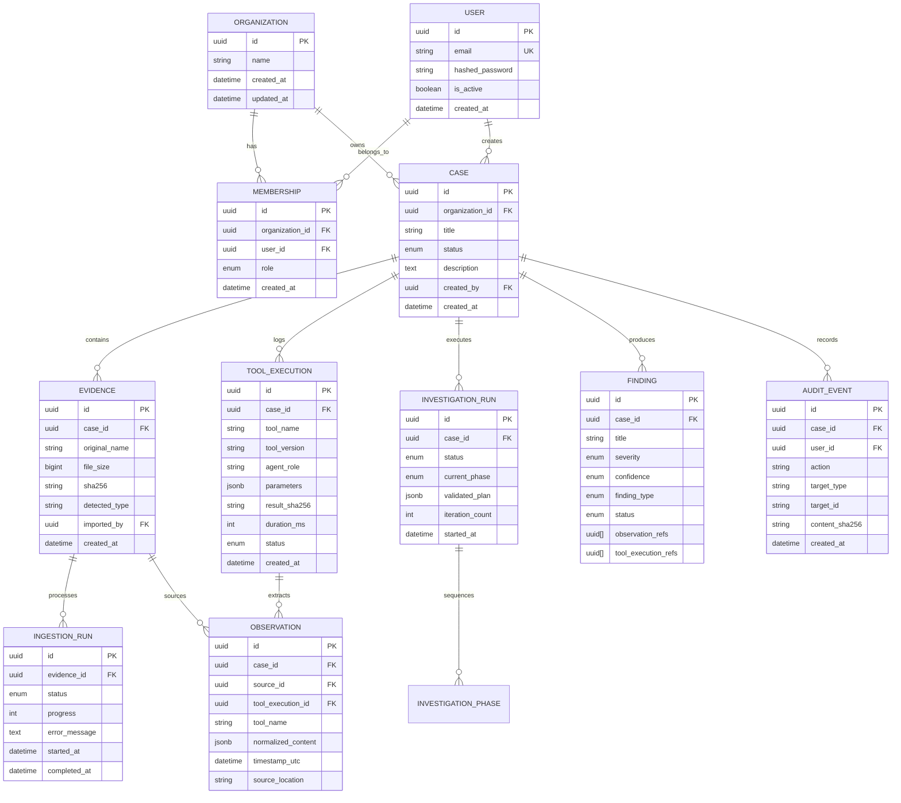

# IRYX Back-End — Socle Applicatif & Moteur d'Investigation Forensique

[](https://www.python.org/)
[](https://fastapi.tiangolo.com)
[](https://www.sqlalchemy.org/)
[](https://www.postgresql.org/)
[](https://github.com/langchain-ai/langgraph)
[](https://docs.celeryq.dev/)
[](tests/)
[](https://docs.astral.sh/ruff/)

---

## 1. Introduction & Périmètre Technique

Ce répertoire contient le code source du back-end de la plateforme **IRYX**. Il implémente :
- L'API REST HTTP asynchrone propulsée par **FastAPI** et validée par **Pydantic v2**.
- Le pipeline asynchrone d'ingestion et de scellement cryptographique des preuves numériques (**Celery + Redis + hashlib**).
- La passerelle sécurisée d'outils forensiques (**Forensic Gateway**) exécutant des analyseurs déterministes confinés (EVTX, Registre Windows, Prefetch, captures mémoires Volatility 3).
- La machine d'états d'investigation pilotée par **LangGraph**, avec persistance transactionnelle des points de contrôle dans PostgreSQL (**AsyncPostgresSaver**) et portes de validation humaine (*Human-in-the-Loop*).
- Le moteur d'analyse, de normalisation d'observations et de certification formelle des constats (**Verifier Déterministe Zéro-LLM**).

---

## 2. Architecture Logicielle : Monolithe Modulaire

Le back-end suit le patron d'architecture en **Monolithe Modulaire** ([ADR-0001](../docs/adr/ADR-0001-monolithe-modulaire-et-workers.md)). Chaque domaine métier réside dans un package dédié et étanche au sein de `src/iryx/`, communiquant par des interfaces de service formelles et sans dépendance circulaire.

```text
src/iryx/
├── ai/                    # Client LLM unifié compatible OpenAI, gestion des réessais & prompts
├── analytics/             # Observations normalisées, Findings & Verifier déterministe
├── api/                   # Dépendances FastAPI partagées (get_db, pagination)
├── auth/                  # Utilisateurs, authentification Argon2, tokens JWT & RBAC
├── cases/                 # Dossiers d'investigation, isolation tenancy & verify_case_access
├── core/                  # Configuration BaseSettings, sécurité, logging JSON, Celery app
├── db/                    # Session SQLAlchemy 2.x, moteur Psycopg 3 & Base déclarative
├── evidence/              # Upload streaming (64 Ko), hachage SHA-256 & tâches d'ingestion
├── gateway/               # Registre d'outils, runner de sous-processus & analyseurs forensiques
│   └── tools/             # Parseurs EVTX, Registre, Prefetch, Volatility 3, Logs/CSV
├── orchestrator/          # Graphe LangGraph, checkpointer PostgreSQL, portes H1/H2
├── organizations/         # Organisations clientes & gestion des adhésions de membres
└── main.py                # Point d'entrée FastAPI, middlewares CORS, gestionnaires d'erreurs
```

### 2.1 Description Détaillée des Modules

#### `iryx.core` — Socle & Configuration
- **`config.py`** : Configuration centralisée basée sur `pydantic-settings.BaseSettings`, chargeant les variables d'environnement (`DATABASE_URL`, `REDIS_URL`, `SECRET_KEY`, timeouts LLM, chemins de stockage).
- **`security.py`** : Fonctions cryptographiques pour le hachage sécurisé des mots de passe (Argon2id via `pwdlib`) et la signature/validation des jetons JWT (PyJWT avec algorithme HS256).
- **`logging.py`** : Journalisation structurée en format JSON natif standard (RFC-compliant), sans dépendance externe lourde, garantissant l'absence de fuite de données confidentielles ou de secrets.
- **`exceptions.py`** : Hiérarchie d'exceptions métier (`EntityNotFoundException`, `AccessDeniedException`, `ValidationException`, `ToolExecutionException`) interceptées par des gestionnaires globaux renvoyant des réponses d'erreur HTTP unifiées (`code`, `message`).
- **`celery_app.py`** : Configuration de l'application Celery utilisant Redis 7 comme courtier de messages.

#### `iryx.db` — Accès Données & Persistance
- **`session.py`** : Initialisation du moteur SQLAlchemy 2.x avec le pilote natif `psycopg` 3 ([ADR-0002](../docs/adr/ADR-0002-postgresql-plutot-que-sqlite.md)), gestion du pool de connexions et fabrique de sessions de requêtage `get_db`.
- **`base.py`** : Classe de base déclarative (`DeclarativeBase`) regroupant les métadonnées de toutes les tables du domaine.

#### `iryx.auth` & `iryx.organizations` — Gestion Multi-Tenant & RBAC
- **Modèle Utilisateur (`User`)** : Comptes sécurisés par mot de passe haché Argon2.
- **Organisation (`Organization`) & Adhésion (`Membership`)** : Cloisonnement strict des équipes. Un utilisateur peut appartenir à plusieurs organisations avec un rôle distinct :
  - `admin` : Administration de l'organisation et gestion des membres.
  - `investigator` : Création et gestion complète des dossiers et téléversement de preuves.
  - `analyst` : Conduite d'enquêtes, création de constats et analyse.
  - `viewer` : Consultation en lecture seule des dossiers autorisés.
- **Contrôles d'autorisation** : Dépendances réutilisables `verify_org_membership` et `require_role(...)`.

#### `iryx.cases` — Dossiers d'Investigation
- Gère le cycle de vie des dossiers (`Case`) : `open` -> `in_progress` -> `review` -> `closed`.
- **Dépendance de sécurité `verify_case_access`** : Injectée sur chaque point d'accès manipulant une ressource fille (preuves, exécutions d'outils, observations, findings). Elle vérifie systématiquement que l'utilisateur connecté possède une adhésion active dans l'organisation propriétaire du dossier.

#### `iryx.evidence` — Ingestion & Scellement des Preuves
- **Téléversement par streaming** : Réception des fichiers multipart diffusés par blocs de 64 Ko vers un répertoire de staging sous UUID unique ([ADR-0005](../docs/adr/ADR-0005-televersement-streaming-et-taille-max-preuves.md)).
- **Intégrité cryptographique** : Calcul systématique de l'empreinte SHA-256 au fil de l'eau. L'écrasement silencieux d'un fichier existant est strictement impossible.
- **Détection binaire** : Identification du format MIME réel par signature magique (`filetype`) sans dépendance système.
- **Tâche asynchrone Celery** : Traitement déporté dans `IngestionRun` ; le client suit l'avancement via polling HTTP avec en-tête `Retry-After: 3` ([ADR-0008](../docs/adr/ADR-0008-protocole-et-cadence-polling-http-retry-after.md)).

#### `iryx.gateway` — Passerelle d'Outils Forensiques & Sandbox
- **`registry.py`** : Registre centralisé listant les outils forensiques autorisés (liste blanche stricte).
- **`runner.py`** : Exécuteur de sous-processus appliquant les politiques de sécurité :
  - Exécution sous utilisateur non privilégié (`non-root`).
  - Coupure réseau (`air-gapped`).
  - Volume de preuves monté exclusivement en lecture seule (`ro`).
  - Temporisation stricte (30 s à 300 s) avec interception des dépassements de timeout.
  - Absence formelle d'interpréteur de commandes (`shell=False`, No-Shell policy).
- **`truncation.py`** : Troncature contextuelle réduisant les sorties d'outils volumineuses à un échantillon représentatif de 50 enregistrements pour préserver la fenêtre de contexte des agents LLM, tout en archivant la sortie brute intégrale en base.

#### `iryx.orchestrator` — Machine d'États LangGraph & Portes Humaines
- **Graphe d'Investigation** : Machine d'états implémentée sous **LangGraph** orchestrant les transitions entre nœuds :
  1. `triage` : Inventaire des artefacts disponibles.
  2. `planner` : Proposition d'un plan d'actions techniques borné (4 à 8 étapes).
  3. `human_gate_h1` : Point d'arrêt bloquant pour arbitrage humain du plan d'investigation.
  4. `executor` : Dispatching ordonné des outils vers la Gateway.
  5. `analyst` : Formulation structurée des hypothèses et constats.
  6. `verifier` : Validation formelle sans LLM.
- **Persistance transactionnelle** : Utilisation de `AsyncPostgresSaver` ([ADR-0007](../docs/adr/ADR-0007-persistance-etat-langgraph-checkpointer-postgresql.md)) garantissant la reprise instantanée de l'enquête au dernier nœud validé après interruption ou redémarrage de worker.

#### `iryx.analytics` — Observations, Constats & Vérificateur Déterministe
- **`Observation`** : Entités unitaires horodatées (UTC) et normalisées extraites des preuves.
- **`Finding`** : Constats d'incident qualifiés par type (`fact`, `inference`, `hypothesis`), sévérité (`low`, `medium`, `high`, `critical`) et confiance (`low`, `medium`, `high`).
- **`Verifier` (Déterministe - Zéro LLM)** : Contrôle mathématique vérifiant que chaque identifiant d'observation ou d'outil référencé existe réellement en base de données pour le dossier en cours. Tout finding non adossé à une preuve matérielle certifiée est rejeté.

#### `iryx.ai` — Client LLM Unifié
- Client unifié basé sur le SDK officiel `openai` ([ADR-0003](../docs/adr/ADR-0003-client-llm-unique-compatible-openai.md)), paramétré par `base_url` et `model`, supportant les fournisseurs compatibles OpenAI en développement (Groq, RodiumAi) ou un modèle open-source auto-hébergé (Gemma via Ollama/vLLM) en production.
- Gestion robuste des réessais avec backoff exponentiel via `tenacity`.
- Protection contre l'injection de prompts indirecte : tout artefact forensique est encapsulé comme donnée passive délimitée par balises XML/JSON.

---

## 3. Modèle de Données & Schéma Relationnel

Le schéma de données est géré sous PostgreSQL 16 via des migrations Alembic versionnées.



---

## 4. Les 14 Règles de Développement du Back-End

Toute contribution au code source doit respecter impérativement ces 14 conventions de conception ([docs/05-conventions-backend.md](../docs/05-conventions-backend.md)) :

1. **Un dossier par module métier** : Package dédié sous `src/iryx/` avec interfaces de service explicites.
2. **Contrôleurs minces (*Thin Controllers*)** : Aucune logique métier dans les routes FastAPI ; délégation exclusive aux services.
3. **Séparation stricte des schémas Pydantic et modèles ORM** : Aucun modèle SQLAlchemy n'est exposé en entrée ou sortie d'API.
4. **Injection de dépendances systématique** : Utilisation de `Depends` pour la session DB, l'utilisateur et les droits.
5. **Vérification d'accès au dossier (`verify_case_access`)** : Obligatoire sur toute route manipulant une ressource liée à un `Case`.
6. **Codes d'erreur standardisés sans fuite d'informations** : Réponses d'erreur HTTP unifiées sans trace d'exception (stack trace) ni chemin système.
7. **Pagination et filtrage systématiques** : Tout endpoint listant des entités accepte `limit` (max 100) et `offset`.
8. **Délégation asynchrone des tâches longues (> 500 ms)** : Ingestion, parsing forensique et inférence délégués à Celery avec retour HTTP 202 et en-tête `Retry-After`.
9. **Évolutions de schéma exclusivement par Alembic** : Aucune modification manuelle de base ; migrations réversibles et testées.
10. **Configuration centralisée par variables d'environnement** : Gestion typée via `pydantic-settings` et documentation dans `.env.example`.
11. **Typage strict et zéro avertissement Ruff** : Annotations de type complètes et conformité stricte au linter/formateur Ruff.
12. **Couverture de tests automatisés obligatoire** : Tests unitaires et d'intégration validant isolation, sécurité et logique métier.
13. **Journalisation structurée JSON sans secrets** : Logs JSON natifs sans mots de passe, tokens ou empreintes de secrets.
14. **Mise à jour synchrone de la documentation** : Toute évolution d'API ou de schéma entraîne la mise à jour des documents sous `docs/`.

---

## 5. Spécifications des Outils Forensiques

| Outil | Entrées Clés | Sortie Normalisée | Timeout | Outil Sous-Jacent |
|---|---|---|---|---|
| `hash_sha256` | `evidence_id`, `offset`, `length` | `sha256_hash`, `bytes_hashed` | 30 s | `hashlib` |
| `parse_text_logs` | `evidence_id`, `format_preset` | Liste d'enregistrements avec `timestamp_utc`, `raw`, `parsed_fields` | 60 s | Python `csv` / regex |
| `parse_evtx` | `evidence_id`, `event_ids`, `max_records` | Événements Windows : `event_id`, `channel`, `computer`, `data` | 180 s | `python-evtx` |
| `parse_registry` | `evidence_id`, `hive_type`, `key_path` | Clés et valeurs : `key`, `name`, `value_type`, `data`, `last_written_utc` | 120 s | `regipy` |
| `parse_execution` | `evidence_id`, `artifact_type` | Exécutions récentes : `executable_name`, `run_count`, `last_execution_utc` | 120 s | `dissect` |
| `analyze_memory` | `evidence_id`, `plugin_name`, `args` | Constats mémoire : `plugin`, `pid`, `process_name`, `timestamp_utc`, `details` | 300 s | `volatility3 == 2.7.0` |

> [!IMPORTANT]
> L'analyseur de mémoire vive Volatility 3 fonctionne en **mode strictement hors ligne** ([ADR-0009](../docs/adr/ADR-0009-mise-a-jour-hors-ligne-symboles-volatility-3.md)) : les tables de symboles ISF Windows sont préchargées localement (`/opt/volatility3/symbols`), interdisant tout téléchargement dynamique sur le réseau.

---

## 6. Référence des Points d'Accès API (Endpoints)

| Méthode | Route | Description | Rôles Autorisés |
|---|---|---|---|
| `POST` | `/api/v1/auth/login` | Authentification utilisateur & délivrance du jeton JWT Bearer | Public |
| `GET` | `/api/v1/auth/me` | Consultation du profil de l'utilisateur connecté | Authentifié |
| `POST` | `/api/v1/organizations` | Création d'une organisation (créateur promu admin) | Authentifié |
| `GET` | `/api/v1/organizations` | Liste paginée des organisations de l'utilisateur | Membre |
| `POST` | `/api/v1/organizations/{org_id}/cases` | Création d'un dossier d'investigation | admin, investigator, analyst |
| `GET` | `/api/v1/organizations/{org_id}/cases` | Liste paginée des dossiers d'une organisation | Tout membre actif |
| `GET` | `/api/v1/cases/{case_id}` | Détail d'un dossier d'investigation | Tout membre actif |
| `PATCH` | `/api/v1/cases/{case_id}/status` | Mise à jour du statut d'un dossier | admin, investigator |
| `POST` | `/api/v1/cases/{case_id}/evidences` | Téléversement streaming multipart d'une preuve | admin, investigator |
| `GET` | `/api/v1/cases/{case_id}/evidences` | Liste paginée des preuves scellées d'un dossier | Tout membre actif |
| `GET` | `/api/v1/cases/{case_id}/evidences/{evidence_id}/ingestion-status` | Polling d'avancement de l'ingestion asynchrone | Tout membre actif |
| `GET` | `/api/v1/cases/{case_id}/tool-executions` | Traces d'audit immuables des exécutions d'outils | Tout membre actif |
| `GET` | `/api/v1/cases/{case_id}/observations` | Consultation paginée et filtrée des observations extraites | Tout membre actif |
| `POST` | `/api/v1/cases/{case_id}/investigations` | Démarrage d'une session d'investigation LangGraph | admin, investigator, analyst |
| `GET` | `/api/v1/cases/{case_id}/investigations` | Historique des sessions d'investigation d'un dossier | Tout membre actif |
| `POST` | `/api/v1/cases/{case_id}/investigations/{run_id}/arbitrate` | **Porte H1** : Arbitrage humain du plan d'investigation | admin, investigator, analyst |
| `POST` | `/api/v1/cases/{case_id}/findings` | Création d'un constat d'investigation (`Finding`) | admin, investigator, analyst |
| `GET` | `/api/v1/cases/{case_id}/findings` | Liste paginée et filtrée des constats techniques | Tout membre actif |
| `GET` | `/api/v1/cases/{case_id}/findings/{finding_id}` | Détail d'un constat d'investigation | Tout membre actif |
| `GET` | `/health` | Vérification de l'état de santé de l'API (`ok`, version) | Public |

---

## 7. Guide d'Installation & Développement Local

### 7.1 Configuration de l'Environnement
```bash
cd backend

# Création de l'environnement virtuel avec uv
uv venv
source .venv/bin/activate  # Sous Windows : .venv\Scripts\Activate.ps1

# Installation de l'ensemble des dépendances et du groupe dev
uv sync
```

### 7.2 Configuration des Variables d'Environnement
```bash
cp .env.example .env
```
Éditez le fichier `.env` pour configurer vos accès PostgreSQL et Redis locaux.

### 7.3 Exécution des Migrations de Base de Données
```bash
# Appliquer toutes les migrations jusqu'à la dernière version
alembic upgrade head

# Créer une nouvelle migration après modification d'un modèle ORM
alembic revision --autogenerate -m "description_du_changement"
```

### 7.4 Lancement du Serveur de Développement
```bash
uvicorn iryx.main:app --host 0.0.0.0 --port 8000 --reload
```
Accédez à la documentation interactive :
- Swagger UI : `http://localhost:8000/docs`
- ReDoc : `http://localhost:8000/redoc`

### 7.5 Lancement du Worker Celery
Dans un second terminal :
```bash
celery -A iryx.core.celery_app worker --loglevel=info --pool=threads --concurrency=4
```

### 7.6 Exécution de la Suite de Tests & Contrôle Qualité
```bash
# Exécuter les 739 tests unitaires et d'intégration
pytest tests/

# Exécuter un fichier de test spécifique
pytest tests/unit/test_verifier_component.py

# Contrôle du linting avec ruff
ruff check .

# Formatage automatique
ruff format .
```
