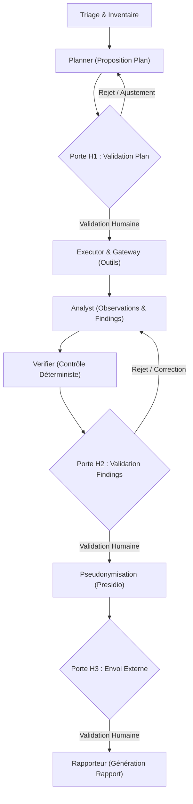

# 04 - Sécurité et Gates : Contrôles, Isolation et Déterminisme
 
---
 
## 1. Intégrité et scellement des preuves
 
1. **Montage en lecture seule** :
   Les répertoires de stockage hébergeant les fichiers de preuves brutes (`Evidence`) sont montés avec l'attribut `ro` (read-only) sur l'ensemble des conteneurs applicatifs et des workers. Aucun processus ne dispose des privilèges nécessaires pour altérer un fichier scellé.
2. **Calcul d'empreinte SHA-256 à l'ingestion** :
   Dès réception par l'API, le composant `IngestionRun` calcule l'empreinte SHA-256 (D-14) du fichier. Cette valeur est enregistrée dans l'entité `Evidence` et fait foi de l'intégrité de la preuve.
3. **Interdiction formelle de l'écrasement silencieux** :
   Si un utilisateur soumet à nouveau un fichier portant le même nom, le système refuse l'écrasement. Il crée une nouvelle entité `Evidence` distincte, trace un événement `AuditEvent`, et conserve le lien vers la preuve d'origine.
 
---
 
## 2. Environnement d'exécution isolé des outils
 
1. **Conteneurisation non-root** :
   Les outils d'investigation s'exécutent exclusivement sous un compte utilisateur non privilégié (`uid 10001:gid 10001`) sans droits sudo ni capacités Linux étendues (`cap_drop: ALL`).
2. **Réseau coupé (Air-gapped execution)** :
   Le conteneur ou processus dédié à l'exécution des outils forensiques tourne sans accès au réseau externe (`network_mode: none`). Tout outil est incapable d'initier une connexion sortante.
3. **Absence d'interpréteur de commandes (No-Shell Policy)** :
   Aucun shell système (`/bin/bash`, `/bin/sh`, PowerShell, cmd) n'est mis à disposition des agents. Les outils de la Gateway sont invoqués via des fonctions Python internes et des sous-processus sans variable de substitution shell (`shell=False`).
 
---
 
## 3. Gestion des secrets et conformité
 
1. **Secrets côté serveur exclusivement** :
   Toutes les clés d'API (OpenAI, RodiumAi, Groq), mots de passe de base de données et secrets JWT résident exclusivement dans des variables d'environnement chargées au démarrage du serveur par `pydantic-settings` (D-04).
2. **Absence de secrets dans les livrables** :
   Aucun jeton, clé secrète ou mot de passe n'est commité dans le dépôt de code, exposé dans les retours d'API front-end, ni visible dans les démonstrations vidéo.
 
---
 
## 4. Isolation stricte des dossiers (`Case`)
 
1. **Contrôle d'accès au niveau route** :
   Chaque requête HTTP accédant à une ressource dépendante d'un `Case` (preuves, observations, findings, rapports) est interceptée par une dépendance FastAPI injectée (`verify_case_access`).
2. **Cloisonnement multi-utilisateurs** :
   Le système vérifie que l'utilisateur authentifié (`User`) est membre actif (`Membership`) de l'organisation détentrice du dossier. L'absence de vérification explicite constitue un défaut bloquant en revue de code.
 
---
 
## 5. Portes de contrôle humain (Human-in-the-Loop Gates)
 
L'orchestrateur LangGraph intègre trois points de blocage obligatoires requérant une validation explicite de l'analyste :
 

 
- **Porte H1 (Validation du plan d'investigation)** :
  L'analyste examine le plan d'outils proposé par l'agent `Planner` (outils choisis, paramètres cibles). Aucun outil ne s'exécute sans l'approbation explicite de H1.
- **Porte H2 (Validation des findings et hypothèses)** :
  L'analyste examine les constats techniques formulés par l'agent `Analyst` après certification par le `Verifier`. L'analyste valide, ajuste la sévérité/confiance ou rejette chaque `Finding`.
- **Porte H3 (Autorisation d'envoi vers un LLM externe)** :
  Toute transmission d'une synthèse d'investigation vers une API externe requiert l'autorisation expresse de l'analyste. Les données brutes de preuves ne sont jamais transmises.
 
---
 
## 6. Pseudonymisation des données avant transmission externe (D-19)
 
Avant toute sollicitation d'un fournisseur LLM externe pour la rédaction assistée d'un rapport :
1. Les entités nommées (noms de personnes, organisations, adresses IP, noms d'hôtes, comptes de domaine) sont analysées et anonymisées via Microsoft Presidio (D-19).
2. Un dictionnaire de correspondances stable au sein du dossier remplace chaque entité sensible par un pseudonyme déterministe (ex. `IP_INTERNAL_1`, `USER_ACCOUNT_A`, `HOST_SERVER_01`).
3. L'analyste peut vérifier la version pseudonymisée avant de donner son accord H3.
 
---
 
## 7. Neutralisation des attaques par injection indirecte (Prompt Injection)
 
Toute chaîne textuelle ou contenu extrait d'un fichier de preuve (ligne de journal EVTX, nom de fichier Prefetch, clé de registre, commande mémoire) est traité strictement comme une **donnée forensique passive**.
- Les données brutes ne sont jamais injectées dans le bloc de consignes (`system prompt`) d'un agent.
- Les données d'observation sont encapsulées dans des conteneurs de données délimités (balises XML ou structures JSON) avec indication formelle que leur contenu ne peut en aucun cas modifier les instructions opérationnelles de l'agent.
 
---
 
## 8. Journalisation d'audit en ajout seul (`AuditEvent`)
 
Chaque événement sensible déclenche l'écriture synchrone d'une ligne dans `AuditEvent` :
- Connexion et authentification utilisateur.
- Accès en lecture ou écriture à un `Case`.
- Téléversement et scellement d'une `Evidence`.
- Invalidation ou exécution d'un outil dans la Gateway.
- Validation, rejet ou modification d'une porte (H1, H2, H3).
- Demande d'export ou génération de rapport.
 
La table est protégée contre toute modification ou suppression au niveau de la couche SQL.
 
---
 
Relecture croisée : Team Lead (Abdoul-Gafar AMADOU) & Product Lead (Abdoul-Gafar AMADOU) - 2026-11-23
